# DoaFácil — Manual de uso

Este manual explica o que é o DoaFácil, como abrir o site e como usar cada parte dele. Ele foi escrito para quem vai usar o site e para a avaliação da disciplina. A documentação para quem desenvolve está em [docs/README-tecnico.md](docs/README-tecnico.md).

---

## 1. Apresentação

**DoaFácil** é uma plataforma web que conecta quem quer doar objetos físicos a quem precisa ou tem interesse neles.

- **Problema que resolve:** muita coisa em bom estado (roupas, livros, móveis, eletrônicos, brinquedos) fica parada em casa ou vai para o lixo porque quem quer doar não sabe para quem, e quem precisa não sabe onde procurar. O DoaFácil reúne essas doações num só lugar, com fotos, condição do item e cidade, e deixa as duas pessoas conversarem para combinar a entrega.
- **Público-alvo:** qualquer pessoa que queira doar um objeto que não usa mais e qualquer pessoa que procure um objeto de que precisa.
- **O que o DoaFácil não é:** não recebe dinheiro (não é vaquinha), não é loja nem marketplace de compra e venda, e não aceita doação de alimentos.

## 2. Acesso ao aplicativo

O DoaFácil **não está publicado na internet** (não há deploy). Para usá-lo, é preciso rodar o site no próprio computador. Os dados (contas, doações, fotos e mensagens) ficam no **Xano**, o backend que o grupo compartilha, então todas as pessoas que rodam o site veem as mesmas doações.

### Requisitos

- **Python 3.10 ou mais recente** (o projeto foi testado com o Python 3.14).
- **Git**, para baixar o projeto.
- **Node.js**: não é preciso instalar à parte. O Reflex, a ferramenta que gera o site, baixa o que precisa na primeira execução.
- **Os endereços do backend (Xano)**: o site precisa de duas variáveis de ambiente, `XANO_API_URL` e `XANO_AUTH_API_URL`. **As duas URLs foram enviadas ao professor no arquivo .txt da entrega.** Elas não ficam no repositório.

### Passo a passo (Windows, PowerShell)

1. Baixe o projeto e entre na pasta:

   ```
   git clone https://github.com/solucaothn/solucao-thn.git
   cd solucao-thn
   ```

2. Crie e ative o ambiente virtual:

   ```
   python -m venv .venv
   .venv\Scripts\Activate.ps1
   ```

   No Linux ou no macOS, use `source .venv/bin/activate`.

3. Instale as dependências:

   ```
   pip install -r requirements.txt
   ```

4. Defina os endereços do backend, copiando as duas URLs do arquivo .txt da entrega. É preciso fazer isso **em cada terminal novo**:

   ```
   $env:XANO_API_URL = "<endereço do grupo Catalog>"
   $env:XANO_AUTH_API_URL = "<endereço do grupo Authentication>"
   ```

   No Linux ou no macOS: `export XANO_API_URL="..."` e `export XANO_AUTH_API_URL="..."`.

5. Rode o site:

   ```
   reflex run
   ```

   A primeira execução demora alguns minutos, porque o Reflex prepara o site.

6. Abra **http://localhost:3000** no navegador. Se a porta 3000 estiver ocupada, o Reflex usa outra e mostra o endereço no terminal.

**Resultado esperado:** a página inicial do DoaFácil, com as doações recentes vindas do Xano.

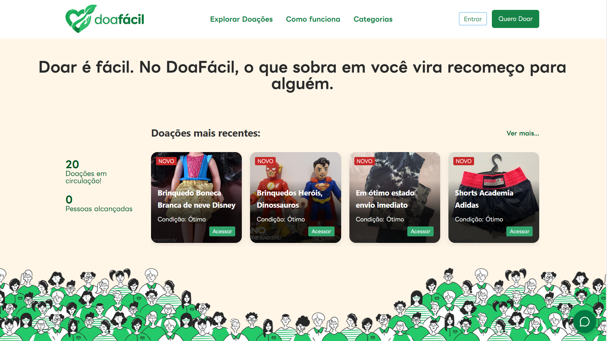

## 3. Perfis de usuários

O site tem três perfis. Uma mesma conta pode doar e ter interesse em doações de outras pessoas.

| Perfil | Quem é | O que pode fazer | O que não pode |
|---|---|---|---|
| **Visitante** | Quem abre o site sem entrar numa conta | Ver a página inicial, explorar e filtrar doações, ver categorias, abrir o detalhe de uma doação e o perfil público de quem doa, ler a Central de ajuda e as páginas institucionais, criar uma conta | Conversar pelo chat, ver o e-mail de quem doa, publicar doações |
| **Quem doa** | Pessoa com conta que publica doações | Tudo o que o visitante faz; publicar doações com até 5 fotos; ver e gerenciar suas doações em “Minhas doações” (editar, reservar, concluir, apagar); responder às conversas no chat; editar o perfil e a foto | Conversar sobre a própria doação pelo botão “Chat”; mudar as fotos de uma doação já publicada |
| **Quem tem interesse** | Pessoa com conta que procura uma doação | Tudo o que o visitante faz; iniciar uma conversa pelo botão “Chat” do detalhe; ver o e-mail de quem doa, quando essa é a forma de contato preferida; editar o perfil | Ver dados privados de quem doa (sobrenome, endereço, e-mail quando a preferência é o chat) |

**Responsabilidades:**

- **Quem doa** descreve o item com honestidade (fotos reais, condição correta), responde às mensagens e atualiza o status da doação (reservada, concluída) para que ninguém procure um item que já foi entregue.
- **Quem tem interesse** conversa com respeito, combina a entrega em local seguro e avisa quando desistir.
- **Todos** seguem os Termos de uso (rodapé do site) e não compartilham dados pessoais além do necessário.

## 4. Funcionalidades

- **Conta:** criar conta com confirmação por código enviado ao e-mail; entrar; recuperar a senha por código; sair.
- **Página inicial:** contador de doações em circulação, doações recentes e busca.
- **Explorar doações:** busca por texto, filtro por estado (UF) e por categoria, e “Carregar mais”.
- **Categorias:** lista de categorias, cada uma levando às doações dela.
- **Detalhe da doação:** galeria de fotos com visualizador ampliado, condição, descrição, categoria, cidade/UF, forma de entrega e de contato, e o cartão “Quem doa”.
- **Perfil público de quem doa:** foto, primeiro nome, cidade, desde quando está no DoaFácil, texto “Sobre”, contadores, e-mail verificado e as outras doações disponíveis da pessoa.
- **Chat:** conversa por doação, com contador de não lidas, indicação de mensagem enviada (✓) e lida (✓✓) e edição da mensagem por até 15 minutos.
- **Publicar doação:** cadastro em 5 passos, com 1 a 5 fotos, ordem das fotos e escolha da capa.
- **Minhas doações:** lista das próprias doações com status, editar, marcar como reservada, disponível ou concluída, e apagar.
- **Editar perfil:** nome, texto “Sobre”, cidade e estado, e foto de perfil com recorte.
- **Central de ajuda e páginas institucionais:** dúvidas frequentes por assunto, Segurança, Termos de uso, Política de privacidade, Quem somos e Fale com a gente.
- **Uso no celular:** layout adaptado e menu ☰.

## 5. Manual de utilização

Cada jornada mostra a sequência de ações, o resultado esperado e um espaço para a captura de tela. Os nomes entre aspas são os textos que aparecem no site.

### 5.1 Criar conta (com código por e-mail)

*Perfil: visitante.*

1. Na página inicial, clique em **“Entrar”** e, na tela de login, em **“Criar conta”**.
   - **Resultado:** abre a tela “Criar sua conta”.

2. Preencha **Nome, E-mail, Cidade, Estado, Senha e Confirmar senha** e clique em **“Criar”**. A senha precisa ter pelo menos 8 caracteres, com letra e número.
   - **Resultado:** o site envia um código de 6 dígitos para o e-mail e abre a tela “Verifique seu e-mail”. Se algum campo estiver errado, a mensagem aparece embaixo dele.
3. Abra o e-mail e copie o código. Ele pode demorar um minuto; olhe também a caixa de spam.
   - **Resultado:** o e-mail do DoaFácil com o código.

4. Digite o código na tela “Verifique seu e-mail” e confirme. O código vale por 10 minutos. Se não chegar, use **“Reenviar código”** (liberado depois de 30 segundos). Para trocar o e-mail, use **“Usar outro e-mail”**.
   - **Resultado:** a conta é criada e o site volta ao login com o aviso “Cadastro confirmado! Você já pode entrar com seu e-mail e sua senha.”.

### 5.2 Entrar e recuperar a senha

*Perfil: quem tem conta.*

1. Clique em **“Entrar”**, informe **E-mail** e **Senha** e clique em **“Entrar”**.
   - **Resultado:** você volta à página inicial, já com o menu da sua conta (inicial e primeiro nome) no topo. Com e-mail ou senha errados, aparece “E-mail ou senha incorretos.”.

2. Esqueceu a senha? Na tela de login, clique em **“Esqueci minha senha”**, informe o e-mail e clique em **“Continuar”**.
   - **Resultado:** se existir conta com esse e-mail, chega um código de 6 dígitos. Por segurança, o site não diz se a conta existe.

3. Digite o código e depois a **Nova senha** e a confirmação, e clique em **“Salvar nova senha”**.
   - **Resultado:** o site volta ao login com o aviso “Senha alterada com sucesso! Entre com a sua nova senha.”.

4. Para sair, abra o menu da conta e clique em **“Sair”**.

> **Observação:** recarregar a mesma aba mantém você conectado. Abrir o site numa aba nova pede o login de novo.

### 5.3 Explorar e filtrar doações

*Perfil: qualquer um.*

1. Na página inicial, use a busca de **“Comece por aqui”** ou clique em **“Explorar Doações”** no menu.
   - **Resultado:** abre a página Explorar, com as doações mais recentes (“Adicionadas recentemente”).

2. No topo, digite um termo (por exemplo, “teclado”), escolha um **estado (UF)** se quiser e clique na lupa.
   - **Resultado:** o título muda para “Resultados para “teclado”” (com “em SP”, se escolheu a UF) e a grade mostra só as doações encontradas. Sem resultado, aparece “Nenhuma doação encontrada” com o botão **“Limpar filtros”**.

   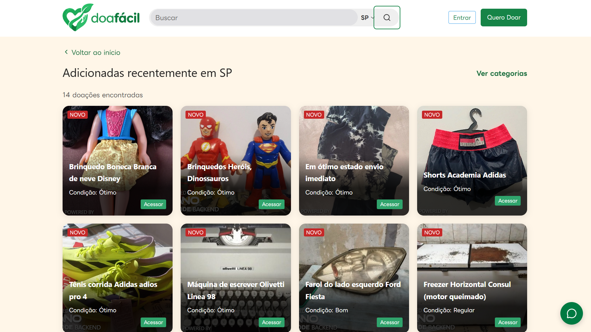

3. Para filtrar por categoria, clique em **“Categorias”** no menu da página inicial (ou em **“Ver categorias”** na Explorar) e escolha uma.
   - **Resultado:** a Explorar mostra só aquela categoria, que aparece como um chip; clique no X do chip (“Remover o filtro de categoria”) para tirar o filtro.

4. Role até o fim e clique em **“Carregar mais”** para ver mais 12 doações.

### 5.4 Ver o detalhe da doação e o perfil de quem doa

*Perfil: qualquer um.*

1. Clique num cartão de doação.
   - **Resultado:** abre o detalhe, com a galeria de fotos, o título, a condição, a descrição, os detalhes (categoria, condição, forma de entrega e preferência de contato), a localização (só cidade e UF) e o cartão “Quem doa”.

   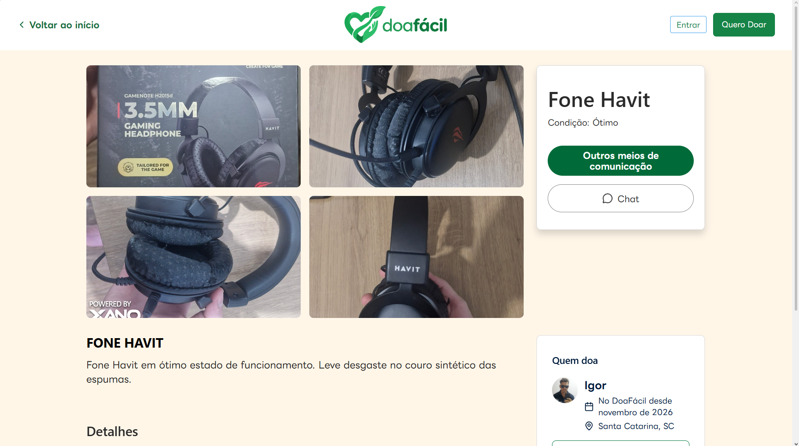

2. Clique numa foto da galeria.
   - **Resultado:** abre o visualizador, com a foto inteira, “N de M”, as setas ‹ › para trocar de foto e o zoom (clique na foto). Feche com o X, com Esc ou clicando fora.

3. No cartão “Quem doa”, clique em **“Ver perfil de quem doa”**.
   - **Resultado:** abre o perfil público, com a foto, o primeiro nome, a cidade, “No DoaFácil desde …”, o texto “Sobre”, os contadores, o e-mail verificado (quando houver) e as outras doações disponíveis da pessoa. **“Voltar à doação”** retorna ao detalhe.

   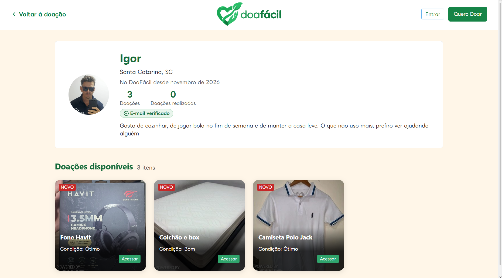

4. Para falar com quem doa, use **“Chat”** (veja 5.5) ou **“Outros meios de comunicação”**. Esse segundo botão exige login. Ele abre o seu programa de e-mail com o endereço de quem doa só quando a preferência dela é e-mail; quando é o chat, aparece “Quem doa prefere contato pelo chat.”.

### 5.5 Conversar pelo chat

*Perfis: quem tem interesse e quem doa.*

1. **Quem tem interesse:** no detalhe da doação, clique em **“Chat”**. Sem login, o site leva ao login primeiro.
   - **Resultado:** abre a página de conversas com a conversa daquela doação. Se a doação não aceitar conversa (por exemplo, se for sua), aparece “Não é possível conversar sobre esta doação pelo chat.”.

   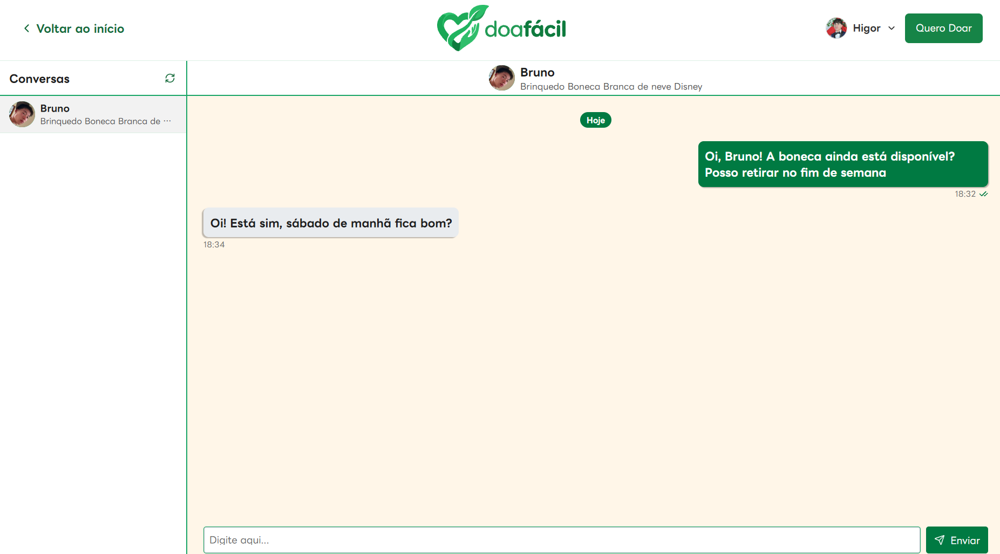

2. Escreva no campo **“Digite aqui...”** e clique em **“Enviar”** (ou tecle Enter). A mensagem pode ter até 1000 caracteres.
   - **Resultado:** a mensagem aparece na conversa com ✓ cinza (“Enviada”). Quando a outra pessoa lê, vira ✓✓ verde (“Lida”). As mensagens novas chegam sozinhas, a cada 25 segundos.
3. **Quem doa:** abra as conversas pelo botão flutuante **“Mensagens”** (no canto da página inicial, da Explorar e das páginas institucionais) ou pelo item **“Mensagens”** do menu.
   - **Resultado:** a lista “Conversas”, com um círculo verde mostrando quantas mensagens não lidas cada conversa tem. O link “Mensagens” da página inicial mostra o total de não lidas.

4. **Editar uma mensagem:** passe o mouse sobre uma mensagem sua enviada há menos de 15 minutos (no celular, toque nela) e clique no lápis **“Editar mensagem”**. Corrija o texto e clique em **“Salvar”** (ou **“Cancelar”**, ou Esc).
   - **Resultado:** a mensagem troca o texto e mostra “(editada)” ao lado do horário. A outra pessoa também vê a versão editada. Depois de 15 minutos, o lápis some.

5. Quando a doação é concluída, a conversa fica **somente para leitura**: o campo e o botão “Enviar” ficam desativados.

### 5.6 Publicar uma doação

*Perfil: quem doa.* Antes, confira se o seu perfil tem cidade e estado: a doação usa essa localização.

1. Clique em **“Quero Doar”**. Sem login, o site leva ao login e depois volta ao cadastro.
   - **Resultado:** abre o cadastro, com a barra de progresso “Passo 1 de 5”.
2. **Passo 1 — “O que você quer doar?”:** informe o **Nome do item** e clique em **“Continuar”**.

   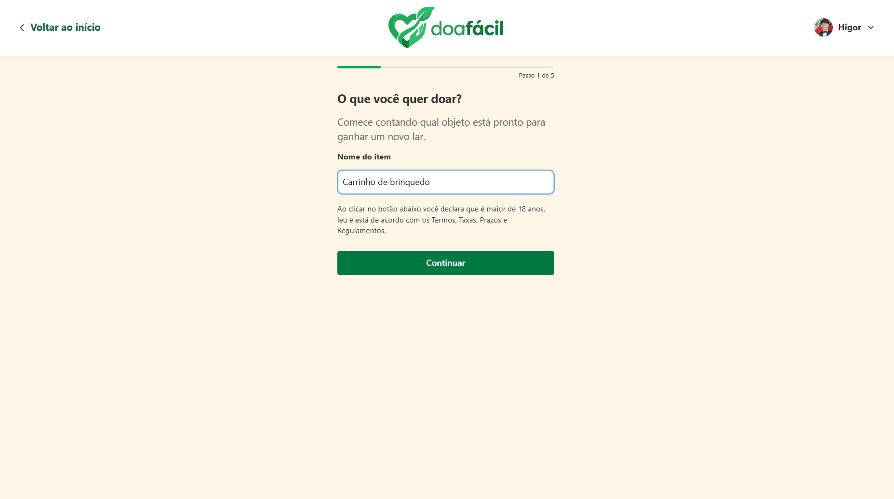

3. **Passo 2 — “Conte mais sobre o item”:** escreva a **Descrição**, escolha a **Categoria** e a **Condição do item** (Ótimo, Bom ou Regular) e clique em **“Continuar”**.

4. **Passo 3 — “Adicione fotos”:** arraste as imagens para a área indicada ou clique para escolher. Aceita de 1 a 5 fotos (JPG, PNG, GIF ou WEBP, até 5 MB cada). A primeira foto é a **capa**.
   - Use as setas para **mover** uma foto para a esquerda ou a direita, **“Tornar … a capa”** para escolher outra capa e a lixeira para **remover**.
   - **Resultado:** as miniaturas aparecem na ordem em que vão ser publicadas, com o selo “Capa” na primeira. Sem nenhuma foto, aparece “Adicione pelo menos uma foto para continuar.”.

   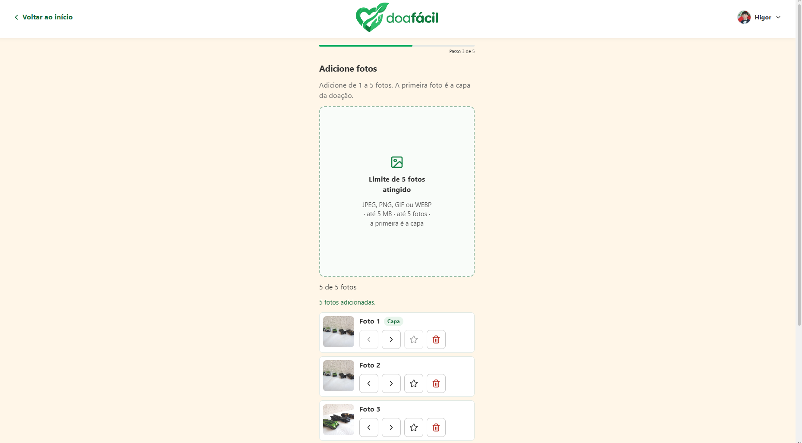

5. **Passo 4 — “Como será a entrega?”:** a forma de entrega é **“A combinar”**, e a localização da doação é a cidade e o estado do seu perfil. Clique em **“Continuar”**.

6. **Passo 5 — “Como prefere que entrem em contato?”:** escolha **“E-mail”** ou **“Chat do DoaFácil”** e clique em **“Publicar doação”**.
   - **Resultado:** a doação é publicada e o site abre o detalhe dela com o aviso “Doação publicada!” e o link “Minhas doações”.

Em qualquer passo, **“Voltar”** retorna ao anterior sem perder o que foi preenchido.

### 5.7 Minhas doações

*Perfil: quem doa.*

1. Abra o menu da conta e clique em **“Minhas doações”**.
   - **Resultado:** a sua página, com o seu cartão (foto, nome, “Sobre”, e-mail e contadores) e a grade das suas doações, cada uma com o selo de status: **Disponível**, **Reservada** ou **Concluída**.

   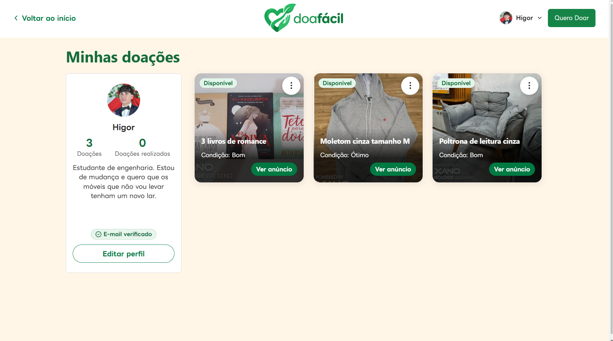

2. Clique no botão de **ações** (⋮) de uma doação. O menu mostra só as ações possíveis para o status dela:

   | Status | Ações |
   |---|---|
   | Disponível | Marcar como reservada, Marcar como concluída, Editar, Apagar |
   | Reservada | Marcar como disponível, Marcar como concluída, Editar, Apagar |
   | Concluída | Apagar |

3. **Reservar:** use quando já combinou a entrega com alguém.
   - **Resultado:** “Doação marcada como reservada.”, e a doação some da busca pública. “Marcar como disponível” desfaz.
4. **Concluir:** depois da entrega, clique em **“Marcar como concluída”** e confirme na janela.
   - **Resultado:** “Doação marcada como concluída.”, e as conversas sobre ela ficam somente para leitura. O contador “Doações realizadas” do seu perfil aumenta.

5. **Editar:** clique em **“Editar”**, mude Nome do item, Descrição, Categoria, Condição do item, Forma de entrega ou Forma de contato e clique em **“Salvar alterações”**. As fotos, a cidade e a UF não mudam por aqui.
   - **Resultado:** volta a “Minhas doações” com o aviso “Alterações salvas.”.

6. **Apagar:** clique em **“Apagar”** e confirme em “Apagar esta doação?”.
   - **Resultado:** “Doação apagada.”, e ela some da lista e do site.

### 5.8 Editar o perfil e a foto (com recorte)

*Perfil: quem tem conta.*

1. Abra o menu da conta e clique em **“Editar perfil”** (ou use o botão “Editar perfil” de “Minhas doações”).
   - **Resultado:** a tela “Editar perfil”, com a prévia de como os outros veem você.

2. Mude **Nome**, **Sobre** (até 300 caracteres), **Cidade** ou **Estado** e clique em **“Salvar alterações”**. O e-mail não pode ser alterado. Só o primeiro nome aparece para outras pessoas.
   - **Resultado:** volta a “Minhas doações” com o aviso “Alterações salvas.”.
3. Para a foto, clique em **“Alterar foto”** e escolha uma imagem (JPG, PNG, GIF ou WEBP, até 5 MB).
   - **Resultado:** abre a janela **“Ajustar foto”**, com uma moldura redonda.
4. Arraste a imagem para enquadrar, ajuste o **Zoom** (pelo controle, pela roda do mouse, pela pinça no celular ou pelas teclas + e −) e clique em **“Usar foto”**. **“Cancelar”** fecha sem mudar nada.
   - **Resultado:** “Foto atualizada.”, e a nova foto aparece no seu perfil, no cartão “Quem doa” das suas doações e no chat.

   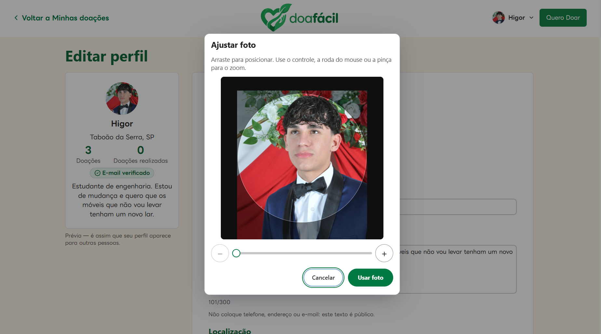

5. Para tirar a foto, clique em **“Remover foto”**. No lugar dela aparece a inicial do seu nome.

### 5.9 Central de ajuda e páginas institucionais

*Perfil: qualquer um.*

1. No rodapé, clique em **“Dúvidas frequentes”**.
   - **Resultado:** abre a Central de ajuda, com os assuntos **Primeiros passos, Doar um item, Receber uma doação, Conta e perfil, Segurança e Conversas**. Cada um abre as perguntas frequentes daquele tema, como “Como publico uma doação?” e “Como funciona o chat?”.

   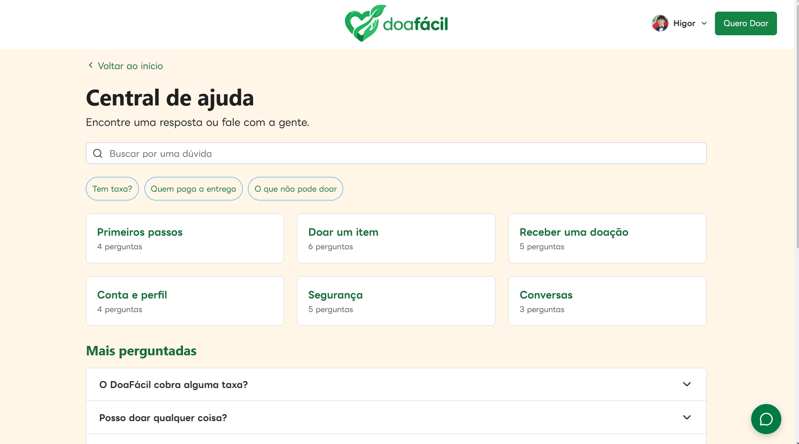

2. Na Central de ajuda, **“Fale com a gente”** abre a página de contato, que mostra o e-mail do projeto (solucaothn@gmail.com). No rodapé também estão **Segurança e transparência, Termos de uso, Política de privacidade** e **Quem somos**.

### 5.10 Uso no celular

*Perfil: qualquer um.*

1. Como o site roda no computador, veja a versão de celular estreitando a janela do navegador ou usando o modo dispositivo das ferramentas do desenvolvedor (F12), com 360 px de largura.
   - **Resultado:** abaixo de 992 px de largura, o layout vira uma coluna, sem rolagem para os lados, e o menu do topo vira o ☰.
2. Toque no **☰** (“Abrir menu”) no topo.
   - **Resultado:** o menu lateral, com **Explorar doações, Como funciona, Categorias e Quero Doar**. Com login, também mostra sua foto ou inicial e o nome, **Minhas doações, Mensagens** (com o total de não lidas), **Editar perfil** e **Sair**. Sem login, mostra **Entrar**.

   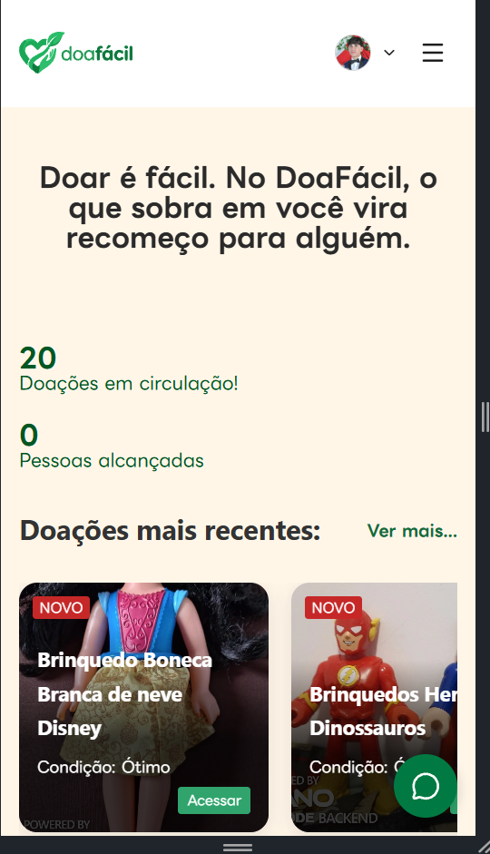

3. No chat pelo celular, a lista de conversas e a conversa aparecem uma de cada vez. Use **“Voltar às conversas”** para voltar à lista.

## 6. Exemplos de utilização

### Cenário completo: Mariana doa um teclado

1. **Mariana cria a conta** (5.1) com cidade Campinas e estado SP e confirma o código recebido no e-mail.
2. **Mariana publica a doação** (5.6): “Teclado musical Yamaha”, com a descrição “Teclado de 61 teclas, com fonte. Funciona perfeitamente.”, categoria de eletrônicos, condição Bom, 3 fotos (escolhe a foto de frente como capa), entrega “A combinar” e contato pelo “Chat do DoaFácil”. O site mostra “Doação publicada!”.
3. **Lucas procura um teclado** (5.3): busca “teclado” na Explorar com a UF SP e encontra a doação da Mariana.
4. **Lucas abre o detalhe** (5.4), vê as fotos no visualizador e abre o perfil da Mariana para ver desde quando ela está no site.
5. **Lucas chama Mariana no chat** (5.5): cria a conta dele, clica em “Chat” e escreve “Oi, Mariana! O teclado ainda está disponível? Posso buscar no sábado.”.
6. **Mariana responde** (5.5): vê o círculo de não lida na lista “Conversas”, abre a conversa e responde. A mensagem do Lucas fica com ✓✓ verde quando ela lê. Ela corrige um horário que digitou errado com o lápis “Editar mensagem”.
7. **Mariana reserva o teclado** (5.7): em “Minhas doações”, usa “Marcar como reservada”. A doação sai da busca enquanto eles combinam.
8. **Depois da entrega, Mariana conclui** (5.7): usa “Marcar como concluída” e confirma. A conversa fica somente para leitura e o contador “Doações realizadas” do perfil dela passa a 1.

### Dados para a demonstração

O repositório não traz dados prontos: a demonstração usa o Xano compartilhado do grupo. Para repetir o cenário, cadastre:

| Item | Valor sugerido |
|---|---|
| Conta de quem doa | Nome “Mariana”, cidade Campinas, estado SP, um e-mail que a pessoa que apresenta consiga abrir (o código chega nele) |
| Conta de quem tem interesse | Nome “Lucas”, cidade Campinas, estado SP, outro e-mail que a pessoa que apresenta consiga abrir |
| Senha das duas contas | Qualquer senha com 8 caracteres ou mais, com letra e número |
| Doação | “Teclado musical Yamaha”, categoria de eletrônicos, condição Bom, 3 fotos próprias, contato pelo chat |
| Mensagens | “Oi, Mariana! O teclado ainda está disponível? Posso buscar no sábado.” e a resposta dela |

Use duas janelas de navegação diferentes (uma normal e uma anônima, por exemplo) para ficar conectado como Mariana e como Lucas ao mesmo tempo. Depois da apresentação, apague a doação de teste em “Minhas doações”.

## 7. Limitações conhecidas

- **Sem deploy:** o site só roda no computador de quem o executa (seção 2), em `http://localhost:3000`. Não há endereço público para abrir no celular ou em outro computador.
- **Plano gratuito do Xano:**
  - as fotos podem aparecer com a marca d'água do Xano;
  - o Xano aceita no máximo **10 pedidos a cada 20 segundos**, somando todas as pessoas. Acima disso, o site mostra “O site está com muitos acessos agora. Tente de novo em instantes.” e é só esperar um pouco.
- **E-mails pelo SendGrid em período de teste:** os códigos de cadastro e de recuperação podem demorar ou cair no spam, e o envio pode parar se o limite do teste acabar.
- **Conta:** não dá para excluir a conta nem trocar a senha ou o e-mail estando conectado. Para trocar a senha, use “Esqueci minha senha” (5.2). Para apagar a conta ou os dados, mande um pedido para **solucaothn@gmail.com**.
- **Sem avaliações:** não há notas, estrelas ou comentários sobre quem doa ou quem recebe.
- **Entrega sempre “A combinar”:** o site não tem frete nem retirada agendada; as pessoas combinam pelo chat ou por e-mail.
- **Categorias fixas:** a lista de categorias é definida pelo grupo e não pode ser criada por quem usa o site.
- **Fotos da doação:** não podem ser trocadas depois de publicar; para mudar as fotos, apague a doação e publique de novo.
- **Sessão por aba:** abrir o site numa aba nova pede o login de novo.

## Equipe

Grupo **Solução THN**:

| Nome |
|---|
| Higor Rodrigues Silva |
| Nicholas Gomes Cardoso |
| Igor Cruz Carvalho |

Contato do projeto: solucaothn@gmail.com

**Documentação técnica:** [docs/README-tecnico.md](docs/README-tecnico.md).

---

## Capturas de tela a tirar

Salve cada imagem em `docs/manual/` com o nome indicado. O README só deve mostrar imagens que existem nessa pasta: uma imagem cujo arquivo não foi salvo sai do manual. As telas do celular podem ser tiradas com o navegador em 360 px de largura (ferramentas do desenvolvedor, modo dispositivo).

| Arquivo | O que mostrar |
|---|---|
| `01-home.png` | Página inicial aberta em `http://localhost:3000`, com as doações recentes |
| `02-explorar-filtros.png` | Explorar com a busca “teclado” e a UF SP aplicadas |
| `03-detalhe.png` | Detalhe de uma doação com várias fotos, o resumo e o cartão “Quem doa” |
| `04-perfil-quem-doa.png` | Perfil público de quem doa, com “No DoaFácil desde” e as doações disponíveis |
| `05-chat-conversa.png` | Conversa aberta com mensagens enviadas (✓) e lidas (✓✓) |
| `06-doar-passo1.png` | Cadastro de doação, passo 1 (“O que você quer doar?”) |
| `07-doar-passo3-fotos.png` | Passo 3 com 3 fotos, o selo “Capa” e os botões de mover e remover |
| `08-minhas-doacoes.png` | Minhas doações com doações de status diferentes |
| `09-editar-perfil-recorte.png` | Editar perfil com a janela “Ajustar foto” aberta (moldura redonda e zoom) |
| `10-central-ajuda.png` | Central de ajuda com os seis assuntos e o botão “Fale com a gente” |
| `11-celular-menu.png` | Menu ☰ aberto em 360 px, com login |

Antes de publicar as capturas, confira que nenhuma mostra e-mail pessoal, senha ou o endereço do Xano.
