# Design do DoaFácil

Link do Figma: https://www.figma.com/design/l4MoQJUROh7b7gY3vCFTC0/doafacil?node-id=73-105&t=wvbRRiL16TnYnhQA-0

As imagens desta pasta são a referência visual do frontend (Reflex). O texto abaixo descreve cada tela e registra as decisões tomadas. Em caso de dúvida entre uma imagem e uma decisão de produto documentada, vale a decisão documentada.

## Identidade visual

- Cor principal: verde. Fundo das páginas: creme claro. Textos em cinza escuro.
- Logotipo "doafácil" (coração com mãos) e ilustração de pessoas no rodapé da home.
- As cores exatas e as fontes devem ser extraídas do Figma ao implementar.
- Páginas novas usam `auth-card-enter` no cartão central de formulários ou `page-fade-enter` no conteúdo principal das demais; ambas respeitam `prefers-reduced-motion`, sem animar cabeçalho, rodapé ou dados carregados do Xano.
- **Campos de texto em todo o site:** o texto digitado ou colado é `#1F1F1F` opaco, e o texto de exemplo (placeholder) é `#6B6B6B` opaco, em qualquer tema do sistema.
  - A regra é global, no `app.style` de `doafacil/doafacil.py`, para todo `input` e `textarea`, com `-webkit-text-fill-color` e `!important`, porque as classes do Radix venceriam um seletor só de elemento.
  - Ficam de fora os campos desativados (como o do chat somente leitura), o `input type="file"` escondido do upload, `hidden`, `checkbox` e `radio`.
  - Não há regras por campo: elas foram removidas quando a regra global entrou (change editar-perfil).
  - Os selects são botões, não campos, e mantêm regra própria para o prompt (`#333333`).

## Telas prontas

### 01-home.png — Tela inicial

- Cabeçalho: logotipo, links **Explorar Doações**, **Como funciona** e **Categorias**, botão **Entrar** e botão **Quero Doar**. Com sessão autenticada, exibe “Olá, <primeiro nome>” e o botão **Sair** no lugar de **Entrar**; esse comportamento é um acréscimo que não está no Figma.
- Frase de destaque: "Doar é fácil. No DoaFácil, o que sobra em você vira recomeço para alguém."
- Estatística: "Doações em circulação".
- Seção **Doações mais recentes**: cartões com foto, etiqueta **NOVO**, título, **Condição** do item (Ótimo, Bom) e botão **Acessar**.
- Cabeçalho, destaque, doações recentes e ilustração ocupam no mínimo a altura da janela (100vh); a ilustração fica no limite inferior quando houver espaço, e "Comece por aqui" só aparece após rolar.
- Se o conteúdo inicial exceder a janela, a área cresce sem cortar conteúdo.
- Ilustração de pessoas em toda a largura, na parte de baixo da primeira área.

### 02-comece-aqui.png — Cartões de entrada

- Na home, esta seção aparece após "Doações mais recentes" e antes da seção institucional e do rodapé.
- A ilustração das pessoas permanece logo abaixo de "Doações mais recentes", em toda a largura e encostada à base da seção; não deve haver faixa de fundo creme entre ela e esta seção.
- Etiqueta "COMECE POR AQUI" e título.
- Abaixo do título, exibir em destaque e negrito: "Leva só alguns minutos: conte o que você quer doar e a gente conecta você a quem precisa."
- Três cartões:
  - **Para você mesmo**: "Escolha um item disponível e receba de alguém que está desapegando."
  - **Ajude quem precisa**: "Cadastre um objeto que você não usa mais e encontre quem precisa."
  - **Desapego em grupo**: "Para família ou uma empresa que quer doar vários itens de uma vez." Exibir a etiqueta **Em breve** e não exibir seta.
- As setas dos dois primeiros cartões são decorativas; nenhum cartão ou controle navega nesta change.
- Abaixo dos cartões, incluir uma barra de busca somente visual: campo "Buscar doações" com placeholder "O que você está procurando?", seletor "Categoria" com a opção "Todas as categorias", seletor "Localização" com a opção "Todas as localizações" e botão "Buscar". Nenhum campo ou botão realiza busca ou navega.
- Em telas estreitas, os campos da barra ficam em coluna.
- A seção usa padding superior próximo de 2.5rem e mantém o padding inferior atual de cerca de 5rem. Espaços: cerca de 1rem entre etiqueta e título, 1.5rem entre título e frase, 3rem entre frase e cartões, e 3rem entre cartões e busca. Line-height aproximado de 1.2 no título e 1.4 na frase.
- Cartões usam gap de cerca de 1.5rem e padding de cerca de 2rem; conteúdo alinhado no topo e seta ou "Em breve" no rodapé.
- Campo e seletores têm fundo branco e borda cinza clara; texto digitado em #333 e placeholder explicitamente em #6b6b6b com opacidade 1; valores dos seletores em cinza escuro legível (aparência ativa), embora a busca continue sem ação.

### 03-secao-institucional-e-rodape.png — Seção institucional e rodapé

**Seção institucional e rodapé da home**

- Título: "Doar no DoaFácil é simples e seguro."
- Texto: "Doações já circularam por aqui, conectando quem tem com quem precisa. Transparência em cada etapa, do anúncio à entrega."
- Quatro cartões com ícone, categoria, título e "Saiba mais", sem fotos ou vídeos:
  - **Solidariedade** — "Conheça histórias de quem doou e quem recebeu".
  - **Segurança** — "Como funciona a autenticação e proteção dos seus dados".
  - **Nossa missão** — "Descubra por que criamos o DoaFácil".
  - **Passo a passo** — "Veja como criar sua doação em poucos minutos".
- Os cartões usam fundos em degradê verde e cinza. Os destinos de "Saiba mais" ainda não existem; os controles não navegam nesta change.
- Rodapé em fundo escuro com logotipo; abaixo dele, duas colunas: "Fale conosco", com o texto "Clique aqui para falar conosco" sem navegação, e "Links rápidos", com os links Quem somos, Doações, Criar doações, Doações mais recentes, Política de privacidade, Termos de uso, Dúvidas frequentes e Segurança e transparência em tamanho reduzido e com pouco espaço entre linhas. Em telas estreitas, as colunas ficam empilhadas.
- Usar no rodapé o mesmo arquivo colorido `assets/logo.svg` do cabeçalho, sem filtro nem recoloração; se o contraste no fundo escuro for ruim, registrar o problema sem alterar a cor por conta própria.
- Títulos do rodapé em 15px; links e "Clique aqui para falar conosco" em 13px, com 6px entre linhas; "Projeto acadêmico DoaFácil" em 12px. "Clique aqui para falar conosco" sem sublinhado.
- Incluir a linha "Projeto acadêmico DoaFácil".
- Não incluir horário, e-mail ou telefone em "Fale conosco".
- Não incluir selo de segurança, CNPJ ou cidade, horário de atendimento, "Busca por recibo" ou "Verificação de links", itens herdados da referência do Vakinha.
- Em telas estreitas, os cartões das seções ficam em coluna.

### 16-landing-nova.png — Nova landing (change landing-nova)

Referência atual da home: o frame `655:2691` (“Frame 18”, 1512 × 2946) do arquivo `doafacil` no Figma. As seções 01 a 03 acima continuam como histórico; onde elas diferem desta, vale esta.

> No PNG, os 4 cartões institucionais estão cobertos por blocos cinza com “foto a definir”. As fotos do Figma têm marca d'água de banco de imagens e não entram no repositório nem no site.

- **Cabeçalho:** “Explorar Doações” (`/explorar`) e “Como funciona” (`/#como-funciona`, a seção institucional da home) são links; “Categorias” abre a gaveta de categorias (veja “18-categorias”, abaixo). Com sessão, o **menu da conta** (círculo com a inicial, primeiro nome e seta) reúne “Minhas doações”, “Editar perfil” e “Sair”; abaixo de 768 px fica só a inicial. Sem sessão, **Entrar**. **Quero Doar** sempre.
- **Título:** como no nó `615:2345` do Figma: LINE Seed JP Bold 36 px, altura de linha normal, `#2A2A2A`, centralizado, 1376 px de largura em 1512 px, quebrando em “…recomeço para” / “alguém.”. Em telas menores, a fonte diminui com a largura (`clamp(1.5rem, 2.4vw, 2.25rem)`).
- **Números:** “Doações em circulação!” (doações disponíveis) e “Pessoas alcançadas” (doações concluídas), ambos vindos de `catalog/donations/count`. Número em Bold 24 px e rótulo em Regular 16 px, em `#005723` (8,9:1 sobre o creme), centralizados na altura dos cartões das recentes.
- **Cartões das recentes:** quadrados entre 220 e 260 px de lado, dividindo a largura do carrossel entre os 4. A linha dos números e do carrossel usa as mesmas bordas do conteúdo do cabeçalho (até 1200 px, com margens de 16 e 24 px), e a coluna dos números tem 11rem. Assim, os 4 cartões cabem em 1512 px; quando não cabem, o carrossel rola dentro dele.
- **“Doações mais recentes:”** com o link **“Ver mais...”** (`/explorar`) à direita.
- **“Comece por aqui”:** “Para você mesmo” leva a `/explorar` e “Ajude quem precisa” a `/cadastro-doacao`; “Desapego em grupo” segue **Em breve**. A busca funciona: categorias do Xano, as 27 UFs e “Buscar” abrindo `/explorar?q=…&categoria=…&uf=…`.
- **Institucional:** fundo creme, título em `#1F1F1F`, texto de apoio em `#166B3B` e quatro cartões quadrados com ícone em círculo verde: Solidariedade — “Histórias que continuam”; Segurança — “Você no controle”; Nossa missão — “Nada se perde”; Passo a passo — “Doar leva minutos”. Sem “Saiba mais”. Desde a change videos-home, o fundo de cada cartão é um vídeo próprio do grupo; o detalhamento está em “Vídeos dos cartões institucionais”, logo abaixo desta lista.
- **Rodapé:** os links navegam (rotas na tabela do guia, seção 8).

#### Vídeos dos cartões institucionais (change videos-home)

- **Arquivos:** os vídeos ficam em `assets/landing/` (`solidariedade`, `seguranca`, `missao` e `passo-a-passo`).
  - Cada um é um `.mp4` H.264 de 490 × 490, o 2x do cartão de 245 px, sem som e com até 8 s, mais a capa `.jpg` de mesmo nome.
  - O `tests/test_videos_home.py` confere isso lendo o cabeçalho do MP4, sem `ffprobe`.
- **Camadas do cartão:**
  1. a capa como fundo;
  2. o `<video autoplay muted loop playsinline preload="metadata" poster>` com `object-fit: cover`;
  3. o véu escuro;
  4. o ícone, o rótulo e o título.
- **Acessibilidade:** o vídeo tem `aria-hidden`, sem controles e fora da ordem do Tab. O texto acessível é o rótulo e o título.
- **Véu (`INSTITUTIONAL_VEIL`):** transparente até 30%, 0,5 em 55% e 0,8 embaixo. É o mais leve com contraste AA do branco sobre as quatro capas (mínimo de 4,9:1, na de “Nada se perde”). O degradê de duas paradas anterior dava só 2,2:1 nessa capa.
- **Movimento reduzido:** com `prefers-reduced-motion`, o `assets/home.css` esconde os vídeos (fica a capa) e um script na montagem da seção tira o `autoplay` e os pausa.

**Diferenças aprovadas em relação ao Figma:**

| No Figma | Na implementação | Motivo |
|---|---|---|
| “Estado: Ótimo” nos cartões | “Condição: Ótimo” | termo do domínio (decisão 6) |
| “COMECE POR AQUI” quase invisível (branco sobre creme) | `#166B3B` | contraste AA; o `#168447` dá só 4,4:1 sobre o creme |
| “Linkes rápidos” | “Links rápidos” | erro de digitação |
| “Desapego em grupo” com seta | “Em breve”, sem seta | a funcionalidade não existe |
| fotos com marca d'água “shutterstock” | vídeos próprios do grupo, sem som, com capa (change videos-home) | direitos de imagem |
| sem “Projeto acadêmico DoaFácil” | a linha continua | exigida pela spec do rodapé |
| 6 cartões de recentes no quadro | até 4 | spec atual; “Ver mais...” leva ao resto |
| cartões de recentes com cerca de 214 px | entre 220 e 260 px, dividindo o carrossel | pedido do grupo: textos legíveis e os 4 cabendo em 1512 px |
| linha dos números e cartões quase até a borda | mesmas bordas do conteúdo do cabeçalho | pedido do grupo |
| números no topo da linha | centralizados na altura dos cartões | pedido do grupo |

### 17-explorar.png e 18-categorias — Explorar doações e categorias (change explorar-categorias)

Referências: os quadros `438:1426` (Explorar), `474:1650` (home com a gaveta de categorias) e `476:2478` (a lista de uma categoria) do Figma. As fotos são das doações de teste do grupo, sem marca d'água.

- **Explorar (`/explorar`):**
  - cabeçalho com o logotipo, a busca (campo “Buscar”, seletor de UF e lupa) e os controles de conta;
  - “Voltar ao início”, o título conforme os filtros (“Adicionadas recentemente”, “Categoria “Roupas””, “Resultados para “…””, com “em SP”) e “Ver categorias”;
  - a categoria aplicada como chip removível;
  - a grade de cartões, “Carregar mais” (12 por vez), o estado vazio com “Limpar filtros” e o botão flutuante do chat.
- **Gaveta de categorias (home):**
  - painel branco à esquerda, com até 500 px de largura e a altura toda da tela;
  - título “Categorias”, o X de fechar e a lista: ícone verde `#168447`, nome em negrito e seta;
  - cada categoria leva a `/explorar?categoria=<id>`.
- **Página `/categorias`:** a mesma lista num cartão branco, com o cabeçalho da Explorar.
- **Lista de uma categoria (476:2478):** é a própria `/explorar?categoria=<id>`.

**Diferenças aprovadas em relação ao Figma:**

| No Figma | Na implementação | Motivo |
|---|---|---|
| “Estado: Ótimo” | “Condição: Ótimo” | termo do domínio (decisão 6) |
| gaveta com “Móveis” | todas as categorias do Xano, inclusive “Móveis”, com ícone de sofá | “Alimentos” foi apagada do Xano; sem exclusão por nome (change correcoes-finais) |
| seta de “expandir” em cada categoria | seta de “ir” (`chevron-right`) | não há subcategorias |
| `/explorar` sem filtro com “Da categoria “Roupas”” | só “Adicionadas recentemente” | decisão do grupo |
| grade fixa de 5 × 245 px | grade flexível, de 220 px para cima | responsivo; uma coluna em 360 px |
| “Voltar ao inicio” | “Voltar ao início” | acento |
| cabeçalho da Explorar sem “Entrar” | “Entrar” ou o menu da conta | consistência da sessão |
| sem link para categorias na Explorar | “Ver categorias” | caminho no celular |

### 19 a 23 — Páginas institucionais (change paginas-institucionais)

Referências do Figma:

| PNG | Quadros | Página |
|---|---|---|
| `19-duvidas-01.png` a `19-duvidas-04.png` | 479:2738, 621:2530, 621:2648 e 621:2752 | Central de ajuda e as categorias (`/duvidas`, `/duvidas/<categoria>`) |
| `20-seguranca.png` | 406:1243 | Segurança e transparência (`/seguranca`) |
| `21-termos.png` | 399:1608 | Termos de uso (`/termos`) |
| `22-privacidade.png` | 396:1040 | Política de privacidade (`/privacidade`) |
| `23-quem-somos.png` | 354:851 | Quem somos (`/quem-somos`) |

Os PNGs não têm marca d'água. As fotos de Segurança e Quem somos são do Freepik e estão no site com crédito (change fotos-site).

- **Comum:** cabeçalho branco só com o logotipo centralizado, “Voltar ao início”, fundo creme, o rodapé da home e o botão flutuante do chat.
- **Central de ajuda:**
  - busca “Buscar por uma dúvida” e os atalhos “Tem taxa?”, “Quem paga a entrega” e “O que não pode doar”;
  - 6 cartões de categoria (nome em `#166B3B` e a quantidade);
  - “Mais perguntadas” num acordeão branco com divisórias, em que o item aberto fica em `#F3F4F6`;
  - a caixa “Não encontrou o que procurava?” com “Fale com a gente”.
- **Segurança:** etiqueta, título e texto à esquerda e a foto à direita, com o crédito “Foto: Freepik” abaixo; o painel cinza com os 4 benefícios e os 2 cartões brancos.
- **Termos e Privacidade:** título, a linha “Documento de projeto acadêmico, sem valor jurídico.”, o link para a outra e seções numeradas. A Privacidade tem a tabela dos dados tratados.
- **Quem somos:** a frase de missão com o traço oval em “doar”, a foto com o crédito “Foto: Freepik” abaixo, os blocos verdes decorativos e “COMO FOI” / “O início do DoaFácil”.
- **Fotos (change fotos-site):**
  - **Formato:** cada foto segue o retângulo do Figma:
    - Quem somos: 375 × 421, cantos de 8 px;
    - Segurança: 507 × 339, cantos de 16 px.
  - **Exibição:** `object-fit: cover`, largura máxima igual à do Figma e altura pela proporção, sem altura fixa; o `alt` é descritivo e em português.
  - **Arquivos:** JPEG 2x (`assets/sobre/quem-somos.jpg` e `assets/seguranca/seguranca.jpg`).
  - **Foto nova:** exporte do Figma em 2x como PNG e rode `python scripts/converter_fotos.py <arquivo.png>`.
    - O script grava o `.jpg` ao lado do PNG, com qualidade 82, sem metadados e com os cantos transparentes em branco.
    - O raio dos cantos vem do CSS: é a metade do raio medido no PNG.
    - Só o `.jpg` entra no commit.
- **Contato (`/contato`, sem tela):** “Fale com a gente”, com o e-mail do projeto (`solucaothn@gmail.com`) escrito e com `mailto:` (change endpoints-antigos).

**Diferenças em relação ao Figma:**

| Tela | No Figma | Na implementação | Motivo |
|---|---|---|---|
| Termos | vaquinha em dinheiro: Pix, cartão, BCB, saques, CPF, telefone, endereço, CNPJ, foro, URLs | textos novos para a doação de objetos, num projeto acadêmico, com o aviso de documento sem valor jurídico | o domínio não é financeiro; nada de empresa ou dado inventado |
| Privacidade | o mesmo, com `lgpd@doafacil.com.br`, cookies e geolocalização | textos novos e a tabela com os dados reais | o site não coleta geolocalização nem usa analytics |
| Central de ajuda | `contato@doafacil.com.br` | “Fale com a gente” → `/contato`, que mostra `solucaothn@gmail.com` (change endpoints-antigos) | o e-mail do Figma não existe; o do projeto foi definido pelo grupo |
| Central de ajuda | “Esta resposta ajudou? Sim / Não” | removido | sem onde guardar o voto |
| Central de ajuda | só 2 respostas e 2 listas de perguntas | as 27 perguntas e respostas, escritas a partir do site | o conteúdo não existe no Figma |
| Central de ajuda | “Nenhuma resposta para “boleto”” com o texto sobre boletos | o texto genérico “Tente outra palavra ou escolha uma categoria.” | a frase só vale para essa palavra |
| Segurança | “Criptografamos todas as informações… transações” | senha com hash, e-mail confirmado por código e fotos sem metadados | não há criptografia de tudo nem transações |
| Segurança | “email e CPF’s validados”; “validação… item doado está correto” | publicação por conta com e-mail confirmado; o site não confere itens | não há CPF nem validação de itens |
| Segurança | “SAIBA MAIS SOIBRE NOSSA” | “SAIBA MAIS SOBRE NOSSA” | erro de digitação |
| Quem somos | “A ideia nasceu em 2019… milhares de doações” | o projeto acadêmico, sem data nem números | não é verdade |
| Segurança, Quem somos | fotos de banco de imagens, sem crédito | as mesmas fotos, em JPEG, com “Foto: Freepik” abaixo (change fotos-site) | a licença grátis do Freepik pede atribuição |
| todas | “Voltar ao inicio” | “Voltar ao início” | acento |
| todas | sem rodapé (só Termos e Privacidade têm) | o rodapé da home em todas | navegação consistente |

### Acabamento (change acabamento)

- **Página não encontrada (404):**
  - cabeçalho comum e fundo creme;
  - “Página não encontrada” e a frase “O endereço pode ter mudado ou não existe mais.”;
  - os links de 44 px “Voltar ao início”, verde cheio, e “Explorar doações”, com contorno.
- **Títulos das abas:** “<Título> | DoaFácil” em todas as páginas, por exemplo “Início”, “Entrar”, “Quero Doar”, “Doação” e “Mensagens”.
- **Favicon:** o símbolo do logotipo, sem o texto. Fica transparente no `.ico` (16, 32 e 48 px) e no PNG de 32 px, e com fundo branco no ícone de atalho de 180 px.
- **Doação indisponível:** “Doação não encontrada”, a frase “Ela pode ter sido reservada, concluída ou removida por quem doou.” e os links “Ver outras doações”, verde cheio, e “Voltar ao início”, com contorno. A página não diz qual foi o caso.
- **Chat sem conversas:** depois de “Você ainda não tem conversas.”, o link “Explorar doações”.
- **Contêiner:** o perfil de quem doa, o detalhe e o Editar perfil passam para os 1200 px de Minhas doações e da Explorar, antes 1396, 1440 e 1236 px. A grade do detalhe não muda.

### Navegação no celular e cabeçalho comum (change navegacao-celular)

O Figma não desenha o celular. A spec é a `site-navigation`.

- **Abaixo de 992 px:**
  - **Botão:** ☰ no cabeçalho, com o rótulo “Abrir menu” e 44 px de área de toque.
  - **Painel:** abre à esquerda, com até 360 px de largura e a altura toda da tela, no mesmo padrão da gaveta de Categorias. Tem o título “Menu”, o X e itens de 48 px com ícone verde `#168447`.
  - **Itens para todos:** Explorar doações, Como funciona, Categorias e Quero Doar, este com fundo verde-claro `#E8F3EC` e texto `#166B3B`.
  - **Com sessão:** a foto ou a inicial e o nome, depois Minhas doações, Mensagens (com o selo de não lidas), Editar perfil e Sair.
  - **Sem sessão:** Entrar.
- **Barra no celular:**
  - **Home, Explorar e Categorias:** logotipo, “Entrar” ou o menu da conta, e o ☰.
  - **Páginas com o logotipo centralizado:** “Voltar” (quando há), logotipo e ☰.
- **Desktop (992 px ou mais):**
  - **Home, Explorar e Categorias:** iguais a antes.
  - **Páginas com o logotipo centralizado:** ganham à direita “Entrar” ou o menu da conta, e “Quero Doar”.
- **Telas de autenticação:** login, cadastro de conta e recuperação de senha continuam só com o logotipo.

**Diferenças em relação ao Figma:**

| Tela | No Figma | Na implementação | Motivo |
|---|---|---|---|
| todas, abaixo de 992 px | não desenhado | botão ☰ e painel lateral com a navegação e a conta | o Figma não tem telas de celular |
| home, Explorar e Categorias, abaixo de 992 px | “Quero Doar” no cabeçalho (desktop) | “Quero Doar” no painel; a barra fica com o logotipo, a conta e o ☰ | não cabem em 360 px |
| institucionais | só o logotipo centralizado | logotipo centralizado e, à direita, “Entrar” ou a conta e “Quero Doar” (desktop) ou ☰ | acesso à conta e ao cadastro de doação em qualquer página |
| detalhe, perfil de quem doa, chat, Minhas doações, Editar doação e Editar perfil | Voltar, logotipo e lado direito vazio | o mesmo, com os controles do site à direita | idem |
| cadastro de doação | só o logotipo | logotipo e a conta à direita, sem “Quero Doar” | é a própria página do “Quero Doar” |
| painel | não existe | “Mensagens” no painel, com o total de não lidas | no celular não há outro caminho para o chat nas páginas sem botão flutuante |

## Telas ainda sem desenho

Login e cadastro, detalhe da doação, formulário de cadastro da doação. “Como funciona” não tem tela: o menu leva à seção institucional da home.

## Referência de estrutura (Vakinha)

O site do Vakinha serve só de inspiração para a organização das páginas. Não copiar marca nem textos, e não incluir o que não se aplica ao DoaFácil: valores em reais, sorteios, avaliações de loja de aplicativos e botões de download de app (o projeto é uma plataforma web).

A referência serve apenas para inspiração estrutural, sem copiar marca ou incluir conteúdo que não tenha sido aprovado para o DoaFácil.

## Decisões tomadas

1. A **localização** da doação é a cidade e o estado do perfil do doador, copiados na hora de cadastrar a doação.
2. A barra de busca pertence à página **Explorar Doações**. A tela "Comece por aqui" é a porta de entrada.
3. A etiqueta **NOVO** vale para doações criadas nos últimos 7 dias.
4. ~~A estatística "Pessoas alcançadas" não entra na primeira versão.~~ Substituída pela change landing-nova: "Pessoas alcançadas" conta as doações concluídas.
5. **Desapego em grupo** (vários itens de uma vez) fica fora do MVP.
6. O rótulo do estado do item é **Condição** (Ótimo, Bom, Regular), para não confundir com o estado geográfico nem com o status da doação.
7. Na seção "Comece por aqui", exibir "Desapego em grupo" com a etiqueta "Em breve" e sem seta. A barra abaixo dos cartões é apenas visual nesta home e não executa busca nem navega; a busca funcional permanece exclusiva da página Explorar Doações.
8. Na seção institucional, usar os quatro cartões Solidariedade, Segurança, Nossa missão e Passo a passo com ícones, categorias, títulos e "Saiba mais", sem fotos ou vídeos; usar degradês verde e cinza. O cartão Solidariedade mantém o título "Conheça histórias de quem doou e quem recebeu", conforme a imagem de referência.
9. Os controles das seções novas, inclusive setas e links, não navegam nesta change porque suas páginas de destino ainda não existem.
10. O rodapé da home usa fundo escuro, logotipo, os oito links rápidos definidos acima e "Projeto acadêmico DoaFácil"; não inclui selo de segurança, CNPJ, cidade, horário de atendimento, "Busca por recibo" ou "Verificação de links" da referência do Vakinha.
11. As seções novas mantêm a fonte LINE Seed JP e a paleta já usada na home; a área principal segue creme e o rodapé é escuro.
12. A ilustração das pessoas permanece logo abaixo das doações recentes, ocupa toda a largura e encosta à base da seção, sem faixa de fundo creme entre ela e "Comece por aqui"; depois aparecem essa seção, a seção institucional e o rodapé escuro, nessa ordem.
13. O rodapé inclui "Fale conosco" com "Clique aqui para falar conosco", sem navegação nem dados de horário, e-mail ou telefone. O bloco fica ao lado de "Links rápidos" abaixo do logotipo em telas largas e empilhado em telas estreitas; título e links rápidos usam tipografia menor e linhas mais compactas.
14. A primeira área da home (cabeçalho, destaque, doações recentes e ilustração) tem no mínimo 100vh, com ilustração encostada à base e sem exibir “Comece por aqui” na primeira dobra; quando o conteúdo ultrapassa a viewport, a área cresce sem cortes.
15. A seção “Comece por aqui” usa espaçamentos e cartões arejados conforme definidos acima; a busca visual tem controles brancos, borda cinza clara e texto legível, sem executar busca.
16. O rodapé preserva o logotipo colorido original, sem filtro; títulos em 15px, links e contato em 13px com 6px entre linhas, texto acadêmico em 12px e texto de contato sem sublinhado.
17. **Change landing-nova:** as decisões 7, 8, 9 e 13 deixam de valer onde falam em controles “sem navegação”, “Saiba mais” e nos títulos antigos dos cartões institucionais. Os cartões, a busca, o menu e o rodapé navegam, inclusive para as rotas futuras, que mostram a página “não encontrada” até serem criadas. Veja “16-landing-nova.png” acima.

## Cadastro de doação: integração com o backend (Xano)

- O wizard usa `/catalog/categories` para carregar categorias e `/auth/profile` para exibir a cidade e a UF do perfil autenticado.
- A publicação completa usa `POST /catalog/donations/publish`; o Xano deriva o doador e a localização da sessão autenticada, valida os campos e persiste até cinco fotos, mantendo a primeira como foto de capa.
- Os arquivos locais em `xano/` incluem os campos aditivos de modalidade de entrega, preferência de contato e localização, além da tabela de fotos e do endpoint de publicação. O `dry-run` do workspace 168184 foi revisado; nenhuma alteração foi enviada ao workspace compartilhado.
- A contagem de doações em circulação e a listagem pública são funcionalidades separadas deste fluxo.

## Telas (imagens)

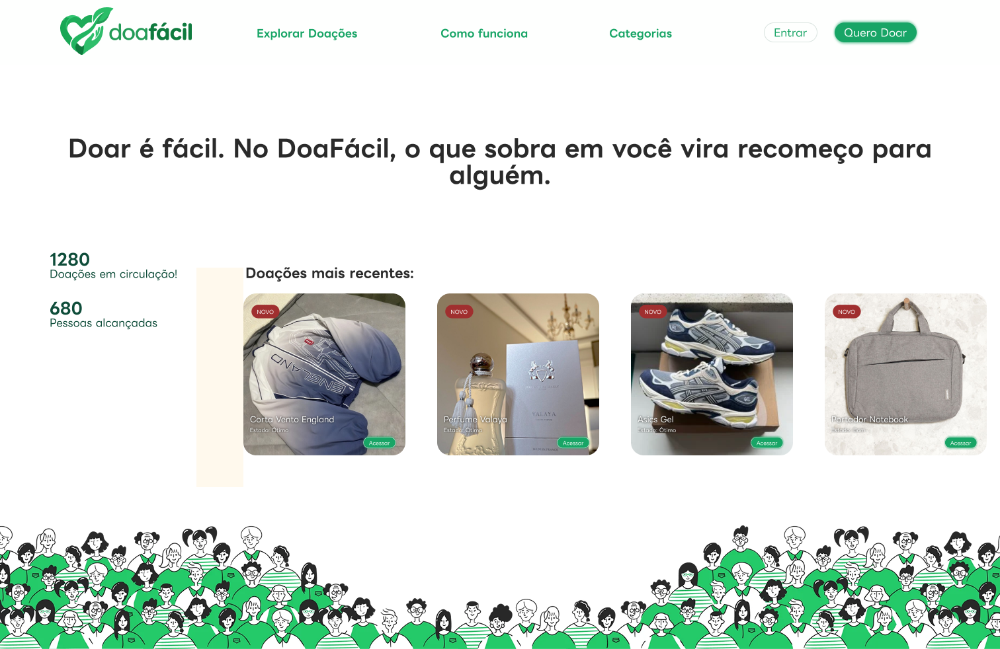

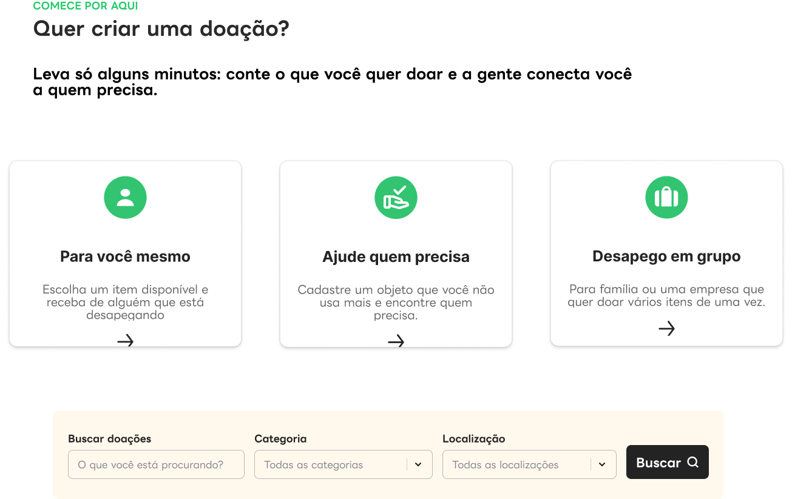

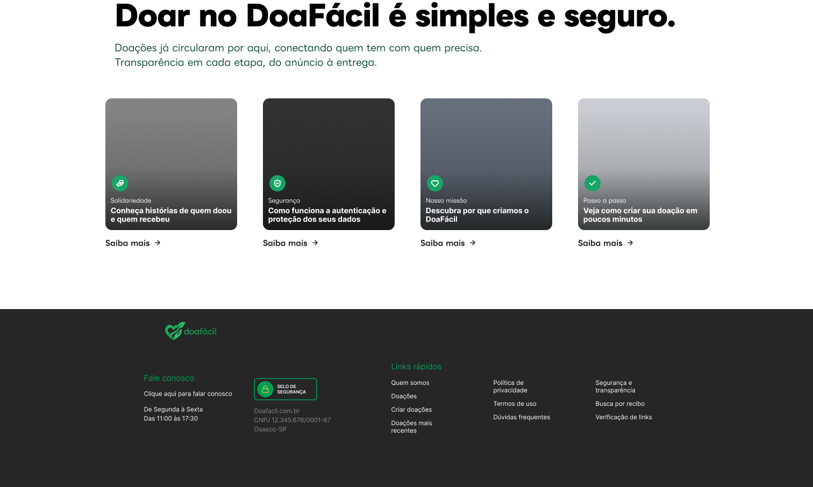

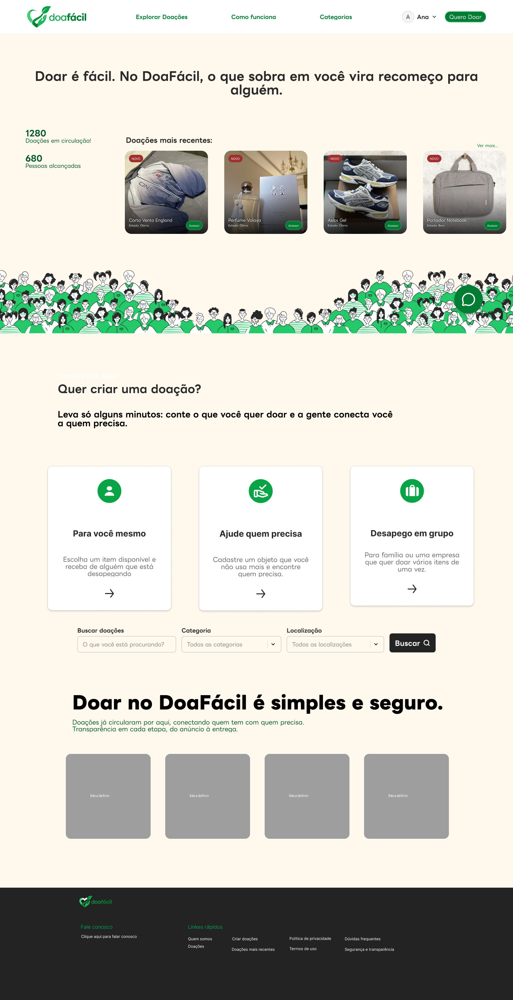

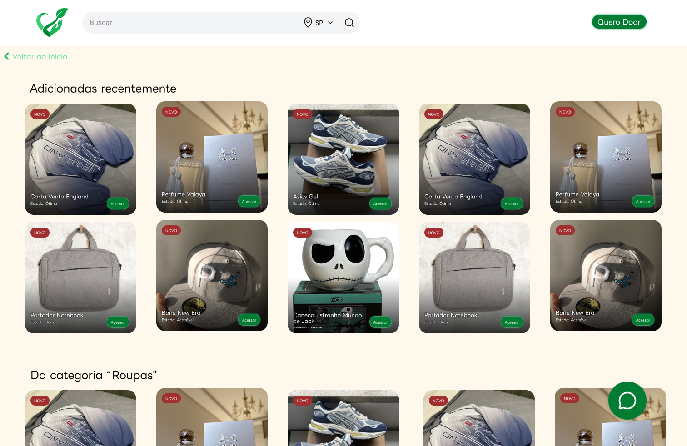

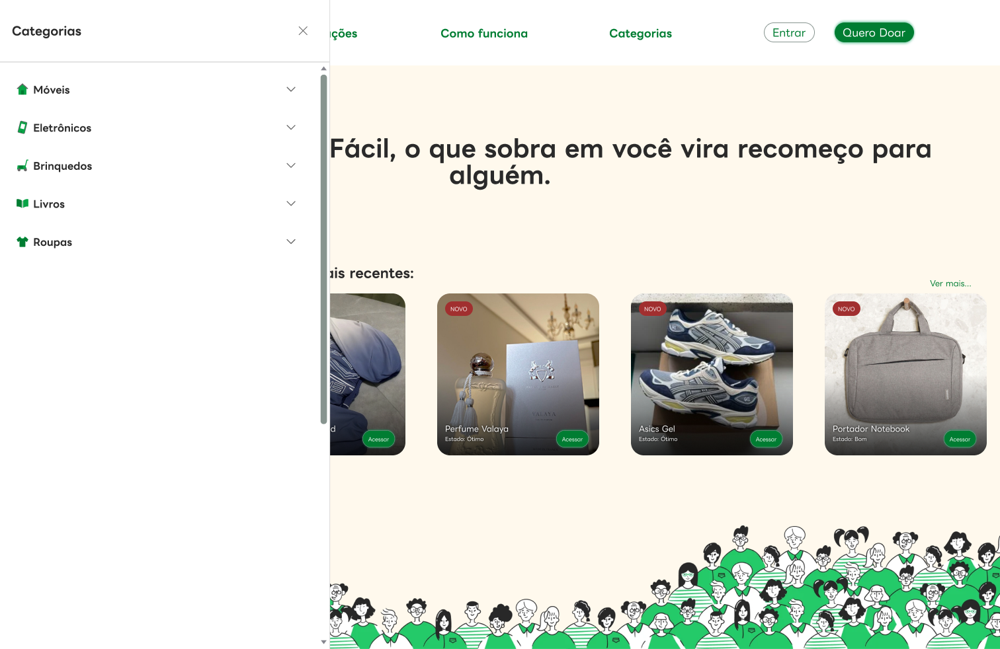

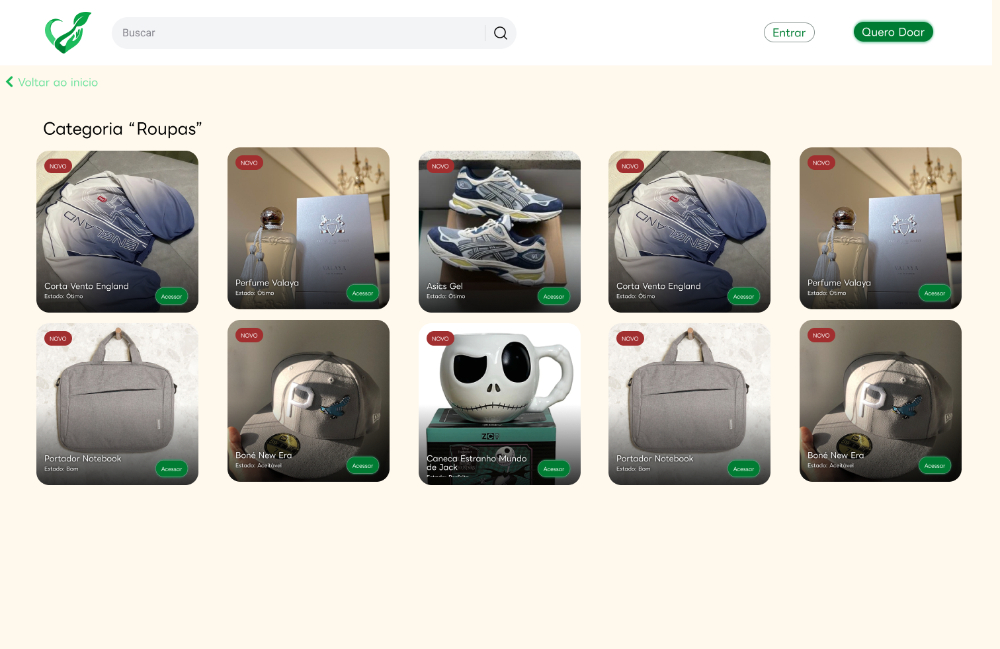

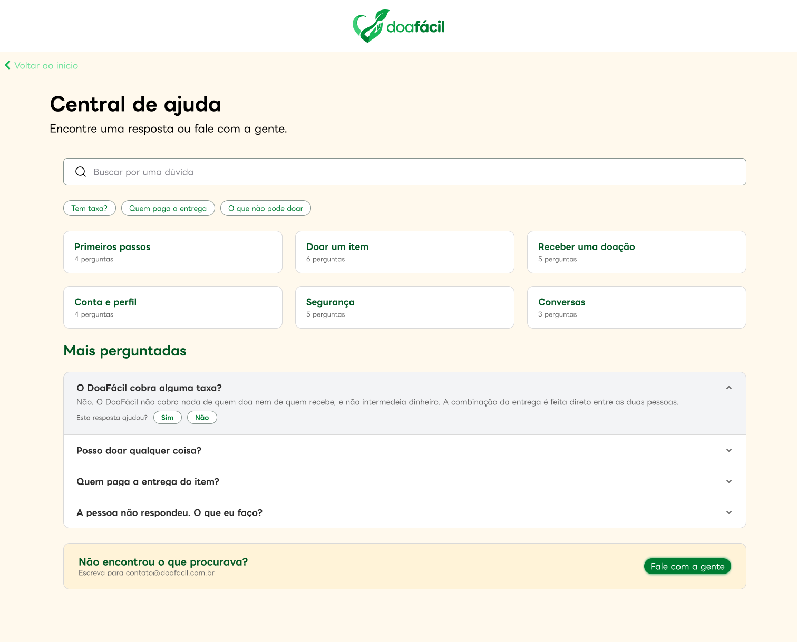

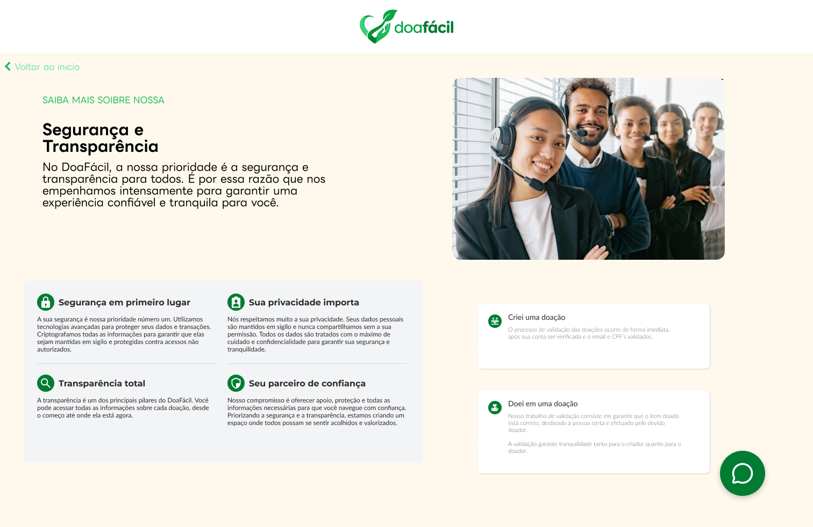

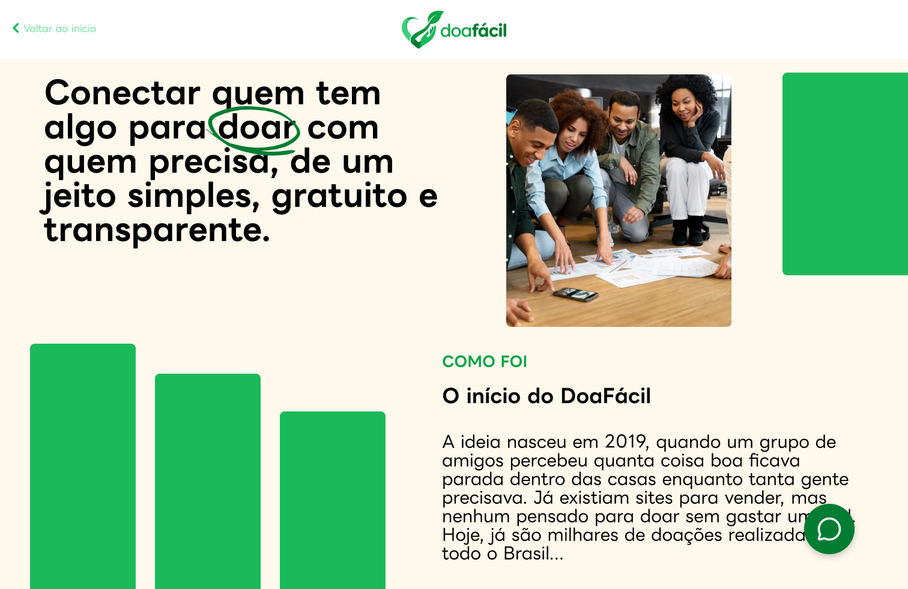

## Novas telas

### 04-login.png — Login

- Cabeçalho branco com o logotipo colorido centralizado; fundo creme na página.
- Cartão branco centralizado com o título "Bem-vindo" e o subtítulo "Entre com seu e-mail e senha".
- Campo "E-mail" com o texto interno "Insira seu e-mail" e campo "Senha" com o texto interno "Insira sua senha".
- O campo Senha tem um botão de olho para mostrar ou ocultar a senha, acréscimo que não está no PNG do Figma.
- O cartão tem uma animação suave de entrada, acréscimo que não está no PNG do Figma.
- Link "← Voltar" acima do cartão, alinhado à esquerda, que retorna para a home em `/`.
- Link pequeno "Esqueci minha senha", alinhado à direita abaixo do campo de senha, sem destino por enquanto.
- Botão verde largo "Entrar".
- Abaixo do cartão, botão pequeno em forma de pílula "Criar conta", que leva para `/cadastro`.
- O login é somente por e-mail. O design original indicava "e-mail ou CPF", mas o CPF foi removido porque o Xano autentica apenas por e-mail e o grupo não decidiu armazenar CPF.

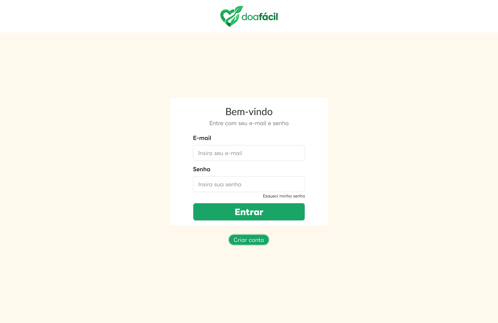

### 05-cadastro-de-conta.png — Cadastro de conta

- Cabeçalho branco com o logotipo colorido centralizado e fundo creme, iguais aos do login; o PNG está sem o logo e com fundo branco, mas esta descrição prevalece sobre a imagem.
- Cartão branco com o título "Criar sua conta" e os campos, nesta ordem: Nome, E-mail, Cidade, Estado, Senha e Confirmar senha. Estado oferece as 27 siglas de UF. Botão verde "Criar".
- Telefone ficou de fora: não existe campo correspondente no Xano e nenhuma funcionalidade deste escopo o utiliza.
- Nome, Cidade, Estado, os botões de olho para mostrar/ocultar as senhas e o link "← Voltar" acima do cartão, alinhado à esquerda e com destino `/login`, são acréscimos que não estão no PNG do Figma.
- O cartão tem uma animação suave de entrada, acréscimo que não está no PNG do Figma.
- O PNG pode conter textos internos desatualizados, como menção a CPF no campo de e-mail e texto incorreto no campo Telefone. Esta descrição prevalece sobre a imagem.

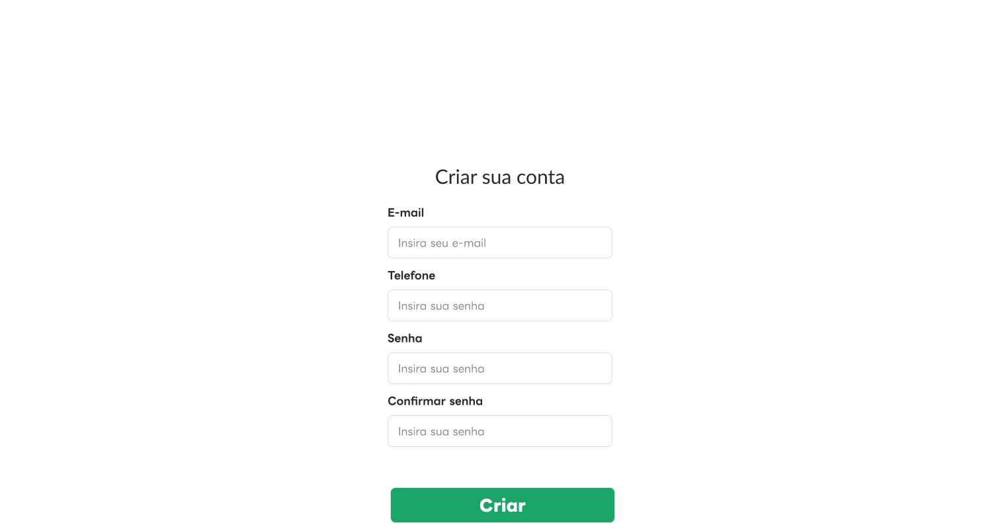

## Cadastro de doação em cinco etapas

As telas de referência adicionadas são:

- [06-cadastro-de-doacao.png](./06-cadastro-de-doacao.png) — item.
- [07-detalhamento-doacao.png](./07-detalhamento-doacao.png) — descrição e categoria.
- [08-fotos-doacao.png](./08-fotos-doacao.png) — seleção de fotos.
- [09-entrega-doacao.png](./09-entrega-doacao.png) — localização e entrega.
- [10-formas-de-contato.png](./10-formas-de-contato.png) — contato e publicação.

1. **Item:** nome da doação.
2. **Detalhes:** descrição, categoria existente e condição (Ótimo, Bom ou Regular).
3. **Fotos:** pelo menos uma e até cinco imagens JPEG, PNG, GIF ou WEBP, de até 5 MB cada, são necessárias para continuar no wizard e publicar a doação. Veja “Passo 3: fotos” abaixo.
4. **Entrega:** modalidade (Retirada, Entrega ou A combinar) e cidade/UF do perfil, sem endereço específico.
5. **Contato e publicação:** preferência (WhatsApp, E-mail ou Chat do DoaFácil), sem solicitar telefone ou outro identificador de contato.

As imagens originais indicam oito etapas e mostram a condição no último passo; o fluxo aprovado nesta change reduz a navegação a cinco etapas e coleta a condição no passo 2. A página usa cabeçalho branco com logotipo centralizado, fundo creme `#FFF6E8`, conteúdo estreito centralizado e animação `auth-card-enter`, que respeita `prefers-reduced-motion`. Os botões primários usam um tom mais escuro de verde com texto branco para manter contraste legível; a barra de progresso conserva `#00A859`. O indicador mostra “Passo X de 5”; a navegação preserva os campos, e erros de serviço não apagam o formulário nem mostram confirmação de publicação.

- **Seta de retorno:** fica no canto superior esquerdo, logo abaixo do cabeçalho, numa faixa de largura total com recuo lateral de 1,25 rem, como no PNG. Não acompanha a coluna centralizada do wizard, fica na mesma posição nas cinco etapas e leva à home (`/`), com o rótulo acessível “Voltar ao início”.
- **Cor dos campos de texto:** em “Nome do item” e “Descrição”, o texto digitado ou colado usa `#1F1F1F`, opaco, aplicado direto no campo para não depender do tema claro ou escuro do sistema. O placeholder usa `#6B6B6B`, igual aos outros formulários, para não parecer texto digitado, e volta a aparecer quando o campo é apagado. Como o placeholder herda o `-webkit-text-fill-color` do campo, a cor dele também é definida nessa propriedade. Os prompts de seleção (“Selecione uma categoria” etc.) e as preferências de contato continuam `#333333`.
- **Selects brancos (change fotos-formulario-doacao):** os quatro selects (Categoria, Condição do item, Forma de entrega e Preferência de contato) usam o select compartilhado de `doafacil/campos.py`, com o estilo no botão visível:
  - fundo branco, borda `#C8C8C8`, 40 px, texto `#1F1F1F`, placeholder `#333333` e foco `#007A42`;
  - antes, o estilo ficava no `Root`, e o botão aparecia cinza, como se estivesse desativado.

### Passo 3: fotos (change fotos-formulario-doacao, sem frame novo no Figma)

- **Texto:** “Adicione de 1 a 5 fotos. A primeira foto é a capa da doação.” No lugar de “Você pode publicar sem fotos.”, que contradizia a regra.
- **Área de escolha:** a mesma área tracejada, agora acessível pelo teclado (Enter ou Espaço).
  - A ajuda é “JPEG, PNG, GIF ou WEBP · até 5 MB · até 5 fotos · a primeira é a capa”, em `#555555`.
  - O ícone é `#168447`.
  - Com 5 fotos, a área fica desativada e mostra “Limite de 5 fotos atingido”.
- **Cada escolha soma às anteriores:**
  - aparece “Preparando fotos...” enquanto as fotos são preparadas, e depois o contador “N de 5 fotos”, anunciado ao leitor de tela;
  - as mensagens de erro são as atuais: formato e limite (“Selecione até cinco imagens JPEG, PNG, GIF ou WEBP.”), tamanho (“A foto pode ter no máximo 5 MB.”), arquivo vazio e leitura;
  - as fotos já aceitas ficam.
- **Lista vertical** (o wizard tem até 360 px). Uma linha por foto:
  - a miniatura de 72 px (`object-fit: cover`), com o texto alternativo “Foto N de M”;
  - “Foto N” e, só na primeira, o selo **“Capa”** (pílula `#E8F5EC` com texto `#166B3B`, 5,8:1);
  - quatro botões de ícone de 44 × 44 px, com contorno `#C8C8C8` e foco `#007A42`:

    | Botão | Ícone | Desativado quando |
    |---|---|---|
    | “Mover foto N para a esquerda” | `chevron-left` | é a primeira foto |
    | “Mover foto N para a direita” | `chevron-right` | é a última foto |
    | “Tornar foto N a capa” | `star` | já é a capa |
    | “Remover foto N” | `trash-2`, em `#B42318` | nunca |

  - Os botões quebram para outra linha quando não cabem, sem rolagem horizontal. Desativados, ficam em cinza claro, sem opacidade parcial.
- **Foco e avisos:** depois de mover, tornar capa ou remover, o foco volta ao botão correspondente, e um aviso curto (“Foto movida para a posição 2.”, “Foto definida como capa.”, “Foto removida.”) é anunciado.
- **Sem arrastar.** Também saíram a lista de nomes de arquivo e “Remover todas”.
- **A ordem da tela é a ordem salva:** a primeira foto é a capa nos cartões e no detalhe.
- **Arquivo enviado:** sem metadados, em pé, com no máximo 1600 px. É PNG só quando há transparência real; nos outros casos, JPEG.
- **Foco dos botões do wizard:** “Voltar”, “Continuar” e “Publicar doação” têm anel `2px solid #007A42`, no lugar do azul do tema.

### Depois de publicar (change fotos-formulario-doacao)

- A página vai para o detalhe da nova doação (`/doacao/<id>`). O passo 5 não mostra mais a mensagem de sucesso.
- No detalhe, uma faixa `#E8F5EC` no topo do conteúdo mostra “Doação publicada!”, em `#166B3B` negrito, e o link sublinhado “Minhas doações” (`#007A42`, 44 px de altura), anunciados ao leitor de tela (`role="status"`).
  - A faixa aparece só nessa chegada e fica até sair da página, sem botão de fechar.
  - Recarregar o detalhe ou abrir outra doação não a mostra.
  - Ela quebra a linha em 360 px e não tem animação própria.

## Recuperação de senha

### 11-esqueci-senha.png — Solicitar código

- Cartão central com o título “Esqueceu a senha?”, campo E-mail e botão “Continuar”; o link “← Voltar” retorna ao login.
- Cabeçalho branco com logotipo, fundo creme e animação `auth-card-enter` somente no cartão.
- A animação e o retorno ao login são acréscimos que não estão no Figma.

### 12-verifique-email.png — Verificar código

- Cartão com o título “Verifique seu e-mail”, campo Código de seis dígitos, dica para verificar o spam, contagem “Reenviar código em 0:30” e botão “Continuar”.
- A tela também é usada para confirmar o cadastro. No fluxo de recuperação, mantém a mensagem neutra atual: “Se existir uma conta com esse e-mail, enviamos um código de 6 dígitos para <e-mail mascarado>.” No fluxo de cadastro, mostra “Se for possível confirmar este e-mail, enviaremos um código de 6 dígitos para <e-mail mascarado>.”
- Em ambos os fluxos, oferece “Usar outro e-mail”. “← Voltar” retorna à solicitação no fluxo de recuperação e a `/cadastro` no fluxo de cadastro.
- Após a confirmação do cadastro, o login mostra o aviso verde “Cadastro confirmado! Você já pode entrar com seu e-mail e sua senha.” abaixo do link “Esqueci minha senha”.
- A máscara, as mensagens neutras, a dica, a contagem, os links, o cabeçalho, o uso compartilhado com cadastro, o aviso de cadastro no login e a animação `auth-card-enter` são acréscimos que não estão no Figma.

### 13-nova-senha.png — Definir nova senha

- Cartão com o título “Altere sua senha”, campos “Nova senha” e “Confirmar senha” e botão “Salvar nova senha”.
- Cada campo tem controle de olho independente; “← Voltar” retorna ao login. Após salvar, o login mostra uma faixa verde de sucesso.
- Os controles de olho, o retorno, a faixa verde e a animação `auth-card-enter` são acréscimos que não estão no Figma.

## Detalhe da doação

### 14-detalhe-doacao.png e 15-detalhe-doacao-resumido.png — Uma página

- As duas imagens representam uma única página de detalhe, não telas ou etapas diferentes.
- A imagem 14 mostra a página inteira, incluindo a galeria, os detalhes e a localização após rolar. A imagem 15 mostra o topo da mesma página, antes de rolar.
- A página usa cabeçalho branco com o logotipo, fundo creme, galeria de fotos e resumo da doação. Abaixo aparecem os detalhes, a localização e o cartão mínimo de quem doa.
- O conteúdo aprovado inclui título, condição, descrição, categoria, cidade/UF, modalidade de entrega e preferência de contato escrita como texto. O cartão de quem doa mostra somente o primeiro nome e a cidade/UF da doação.
- A página é pública e exibe somente doações disponíveis. Um identificador inválido, uma doação inexistente ou uma doação indisponível apresenta “Doação não encontrada”. Falhas de rede ou respostas inválidas apresentam uma mensagem de erro.
- O conteúdo estático usa `page-fade-enter`, respeitando `prefers-reduced-motion`; cabeçalho e dados carregados do Xano não são animados.

### Frames `detalhes-doacao-inteira` e `detalhes-doacao-1` do Figma — layout atual

A referência de layout são esses dois frames do Figma, que só diferem no cartão do anunciante. Esta seção prevalece sobre eles e sobre as imagens 14 e 15.

O que segue o Figma:

- **Cabeçalho:** branco, com o logotipo centralizado e “Voltar ao início” à esquerda na mesma linha. É o mesmo cabeçalho do chat (`back_home_header()`), com seta verde `#166B3B` e rótulo acessível “Voltar ao início”. Em telas estreitas aparece só a seta, numa área de toque de 44 px.
- **Galeria:** a capa grande (470 px de altura no computador) e, ao lado, até 4 miniaturas em grade 2×2, com 16 px entre as fotos e cantos de 8 px.
- **Uma foto só:** a capa ocupa toda a largura da galeria e mostra a imagem inteira (`contain`), centralizada, com fundo neutro `#EEEEEE` nas sobras e a mesma altura. Nada é cortado.
- **Cartão de resumo, à direita da galeria:**
  - branco, com borda `#D9D9D9`, cantos de 8 px e sombra `0 8px 13px rgba(0,0,0,0.15)`;
  - o título grande (2,4 rem) e “Condição: …”;
  - o botão em pílula “Outros meios de comunicação” e o botão “Chat” branco com borda `#85858D`.
- **Título e descrição logo abaixo da galeria:** o título em negrito, em caixa alta e preto; a descrição em texto corrido, mantendo as quebras de linha. O título aparece nos dois lugares, como no Figma.
- **“Detalhes”:** uma grade em que cada item tem o ícone verde do Figma (`assets/detalhe-atributo.svg`), um rótulo pequeno e o valor logo abaixo. Os itens são Categoria, Condição, Forma de entrega e Preferência de contato. A grade tem 4 colunas em telas largas, 2 em médias e 1 no celular.
- **“Localização”:** a ilustração de edifícios do Figma (`assets/detalhe-localizacao.svg`, 56 px) e “Cidade, UF”.
- **“Quem doa”:** à direita, abaixo do resumo, como o cartão do anunciante do Figma: branco, com borda `#D9D9D9`, a foto de perfil de 48 px (ou o círculo `#F2F2F2` com a inicial) ao lado do primeiro nome, e o ícone de local com “Cidade, UF”. A foto entrou com a change foto-perfil. O cartão inteiro é o link para o perfil público (veja “Perfil público de quem doa”).
  - Abaixo da cidade, numa linha, os contadores “Doações” e “Doações realizadas” e, abaixo deles, o selo “E-mail verificado”, só quando o e-mail de quem doa está verificado. Entraram com a change perfil-credibilidade e usam os componentes compartilhados (veja “Contadores e selo ‘E-mail verificado’”). O e-mail nunca aparece.
- **No celular:** uma coluna, na ordem galeria → resumo → título e descrição → Detalhes → Localização → Quem doa, com 16 px de margem e sem rolagem horizontal.

Diferenças aprovadas em relação ao Figma:

- **Botão principal em `#007A42`** (o verde AA do projeto, hover `#006B39`), no lugar do `#007D32` do Figma e do `#00A859` antigo, que tinha cerca de 2,9:1 com o texto branco.
- **Fonte LINE Seed JP** em tudo, como no resto do site, no lugar da Roboto do Figma.
- **Rótulos da grade com 0,75 rem** (12 px), e não 10 px, para ficarem legíveis. O texto usa `#2A2A2A` e `#555555`, e o cartão de quem doa `#001C3C`, todos com contraste AA.
- **Fundo creme `#FFF6E8`**, como no resto do site, no lugar do `#FFF9ED`.
- **“Condição”** no lugar do “Estado” do Figma, como pede a spec.
- **Caixa alta do título só no visual** (`text-transform: uppercase`); o texto lido continua o original.
- **“Localização” num cartão branco** com borda, no lugar das divisórias do Figma, e com uma só linha: “Cidade, UF”.
- **Sem “NOVO” e sem status:** o detalhe não recebe a data de criação e só mostra doações disponíveis (decisão do grupo).
- **Ícones decorativos:** os dois SVGs do Figma têm `alt=""` e `aria-hidden`.
- **Cartão “Quem doa” como link (não está no Figma):** leva a `/doacao/<id>/quem-doa`, com o id da doação aberta.
  - O rótulo acessível é “Ver perfil de <primeiro nome>”.
  - Uma linha “Ver perfil”, com o ícone `chevron-right` em `#007A42`, mostra que o cartão é clicável.
  - No hover, a borda fica `#007A42`; o foco tem contorno de 2 px em `#007A42`.
  - É o único acesso ao perfil no detalhe: não há outro botão de perfil.
- **Visualizador de fotos (não está no Figma):** cada foto da galeria é um botão, com rótulo como “Ampliar foto 2 de 5” e cursor de lupa.
  - **Abrir:** clicar, Enter ou Espaço abre um modal em tela cheia com fundo creme semitransparente (`rgba(255, 246, 232, 0.85)`) e desfoque de 6 px, sem o véu escuro padrão do diálogo. Textos e ícones em `#1F1F1F`.
  - **Foto em 1x:** inteira (`contain`), cabendo abaixo do cabeçalho de 80 px, sem passar da borda de baixo nem das laterais.
  - **Controles:**
    - no alto, o contador “N de M” e o botão X (“Fechar”);
    - nas laterais, ‹ (“Foto anterior”) e › (“Próxima foto”), que dão a volta e só existem com mais de uma foto;
    - todos com 48 px, fundo branco, sombra leve e ícone escuro, a 16 px das bordas visíveis em qualquer largura.
  - **Zoom:** clicar na foto alterna entre 1x e 2x (“Ampliar foto” / “Reduzir foto”); em 2x, a rolagem move a imagem. No celular vale a pinça do navegador.
  - **Teclado e fechamento:** ← e → trocam a foto; Esc, o X ou um clique no fundo fecham. O foco fica preso no modal e volta à página ao fechar (diálogo do Radix).

### Elementos fora do escopo desta versão

Cor, Material e Tipo, que aparecem no Figma, não existem no cadastro e não são criados. Bairro, zona, CEP e dados além do primeiro nome do doador são omitidos para preservar a privacidade: a localização pública é só cidade e UF. Avaliações e presença online dependem de dados ou funcionalidades que ainda não existem. O único indicador de verificação é o selo “E-mail verificado” do cartão “Quem doa”. As outras doações de quem doa aparecem só no perfil público, não no detalhe. O cartão do topo mostra "Outros meios de comunicação", que abre o e-mail de quem doa só para quem está logado e só quando a preferência é E-mail, e "Chat", que inicia ou reabre a conversa e abre `/chat` (veja a seção “Chat”). O perfil público é aberto só pelo cartão “Quem doa”; o botão “Acessar perfil do doador” do Figma não é usado.

## Perfil público de quem doa

### Frames `perfil-doador-01` e `perfil-doador-02` do Figma — página `/doacao/<id>/quem-doa`

A referência são os frames `perfil-doador-01` (com doações, dentro do grupo `Group 8`) e `perfil-doador-02` (sem doações), ainda sem PNG em `docs/design`. Esta seção prevalece sobre eles.

O perfil é aberto a partir de uma doação (o cartão “Quem doa” do detalhe), nunca por id de usuário. A página só mostra dados que o endpoint público `catalog/donations/donor` devolve.

O que segue o Figma:

- **Fundo creme `#FFF6E8`**, com conteúdo de até 1396 px e 16 px de margem lateral no celular.
- **Cartão de identificação:**
  - branco, com borda `#D9D9D9` e cantos de 8 px;
  - à esquerda, a foto de perfil redonda (ou, sem foto, o círculo `#F2F2F2` com a inicial do primeiro nome em `#555555`), de 120 px no computador e 72 px no celular;
  - o primeiro nome como título (`h1`) em `#166B3B`, “Cidade, UF” em `#2A2A2A` e “No DoaFácil desde <mês> de <ano>” em `#555555`, com o mês por extenso.
  - abaixo, os **contadores** “Doações” e “Doações realizadas” e o selo **“E-mail verificado”** (só quando verificado), que entraram com a change perfil-credibilidade.
    - “Doações” soma as disponíveis e as **reservadas** de quem doa. Por isso pode ser maior que o “N itens” de “Doações disponíveis”, que conta só as disponíveis e é o total da lista. A diferença é intencional (decisão do grupo).
  - abaixo, o **Sobre** de quem doa, que entrou na change editar-perfil. Vai em `#2A2A2A`, como texto simples, com as quebras de linha. Com o Sobre vazio, não aparece nada: nem título, nem espaço reservado.
  - No celular, o círculo fica acima do texto, e tudo fica centralizado.
- **“Doações disponíveis”** (`h2` em `#166B3B`), com o contador “1 item” ou “N itens” em `#555555` ao lado.
- **Cartões iguais aos da home:** foto (ou a imagem genérica), título, “Condição: …”, NOVO para doações de até 7 dias e “Acessar”, que leva a `/doacao/<id>` do item.
  - Ficam numa grade `repeat(auto-fill, minmax(220px, 1fr))` com 24 px entre os cartões: 5 colunas a 1512 px e 1 a 360 px.
  - Na grade, o cartão ocupa a largura da célula, em vez do tamanho fixo do carrossel da home (260 px desde a change landing-nova).
- **Estado vazio (`perfil-doador-02`):** cartão branco centralizado com “Nenhuma doação disponível no momento” (`#166B3B`, negrito), a frase “Quando <nome> publicar uma nova doação, ela aparece aqui.” e o link “Explorar outras doações” (`#007A42`), que leva a `/explorar` (change correcoes-finais). Sem contador e sem paginação.
- **Erro do perfil:** a mensagem e o botão “Tentar de novo” (contorno `#166B3B`, 44 px), que busca o perfil outra vez. O “Doação não encontrada” não tem o botão (change correcoes-finais).

Diferenças aprovadas em relação ao Figma:

- **“Voltar à doação”** na linha do logotipo, à esquerda, em `#007A42`, no lugar do verde claro do Figma, que não tinha contraste AA. É o mesmo cabeçalho do chat e do detalhe (`back_link_header()`), com rótulo acessível e área de toque de 44 px; em telas estreitas aparece só a seta.
  - Leva a `/doacao/<id>` da doação de origem. Com um id inválido na rota, leva a `/`.
  - Os frames não têm a linha do logotipo; ela entra para o perfil ficar igual às outras páginas.
- **Foto de perfil:** entrou com a change foto-perfil. A foto é cortada em círculo (`object-fit: cover`), tem o texto alternativo “Foto de <primeiro nome>” e é a foto **atual** da pessoa. Sem foto, fica o círculo com a inicial, do mesmo tamanho.
- **Sem o botão de chat e sem avaliações.** Esses itens não aparecem nem como “Em breve”. O selo “E-mail verificado” aparece desde a change perfil-credibilidade. O botão flutuante do chat também não aparece no perfil.
- **Só o primeiro nome:** nada de sobrenome ou e-mail. A cidade e a UF são as da doação de origem, o mesmo dado que o detalhe já mostra.
- **Paginação, que não está no Figma:** de 12 em 12, só quando há mais de uma página.
  - Os botões “Anterior” e “Próxima” têm contorno `#007A42` e 44 px de altura, e o texto “Página N de M” é anunciado ao leitor de tela (`aria-live="polite"`).
  - “Anterior” fica desativado na primeira página e “Próxima” na última. Os dois ficam desativados durante o carregamento.
  - Cada troca faz uma requisição só para a página pedida. Com erro, a página anterior continua visível e a mensagem aparece abaixo dos botões.
  - Recarregar a página volta à página 1: a página da lista não fica na URL.
- **Estados:**
  - “Carregando perfil...” enquanto busca;
  - “Doação não encontrada” para um id inválido (sem consultar o Xano) ou para uma doação inexistente ou indisponível;
  - uma mensagem de erro simples para falha de rede, resposta inválida ou limite de acessos (429).
- **Fonte LINE Seed JP** e as cores AA do projeto, como no resto do site. Todos os pares passam de 4,5:1. Os de menor contraste são `#007A42` sobre o creme (5,1:1) e `#555555` sobre o `#F2F2F2` do círculo (6,7:1).
- **Animação:** `page-fade-enter`, que respeita `prefers-reduced-motion`, só nos títulos fixos (“Doações disponíveis”, o título do estado vazio) e nas mensagens de estado. O cabeçalho, o cartão de identificação e os cartões de doação, que vêm do Xano, não animam.

## Contadores e selo “E-mail verificado”

Componentes compartilhados de `doafacil/perfil_publico.py`, usados em “Minhas doações”, na prévia de `/perfil/editar`, no perfil público e no cartão “Quem doa” (change perfil-credibilidade).

- **Contadores (`donation_counts`):** o número em `#166B3B` (1,5 rem, negrito) e o rótulo em `#555555` abaixo. São “Doações” (disponíveis e reservadas) e “Doações realizadas” (concluídas), com “Doação” e “Doação realizada” quando o número é 1.
- **Selo (`verified_badge`):**
  - uma pílula com o ícone `badge-check` e o texto “E-mail verificado”, em `#166B3B` sobre `#E8F5EC` (5,8:1), com borda `#B7DEC4` e cantos de 999 px;
  - o ícone é decorativo (`aria-hidden`), e o leitor de tela lê só o texto;
  - a largura é a do conteúdo, até 100 % do cartão, e o texto quebra a linha se for preciso (360 px sem rolagem);
  - sem o e-mail verificado, não aparece nada: nem “não verificado”, nem espaço reservado;
  - contas antigas, criadas antes de 2026-11-04 ou sem a confirmação do e-mail, ficam sem selo.
- **Sem animação:** os dois vêm do Xano e não animam.

## Minhas doações

### Frame `Group 6` (`meu-perfil-1`) do Figma — página `/minhas-doacoes`

A referência é o frame `Group 6` do arquivo do Figma, ainda sem PNG em `docs/design`. Esta seção prevalece sobre ele. A página só abre com login; sem login, leva a `/login`.

O que segue o Figma:

- **Fundo creme `#FFF6E8`,** com o título “Minhas doações” acima do conteúdo.
- **Cartão da pessoa, à esquerda:**
  - branco, com borda `#D9D9D9` e cantos de 8 px;
  - a foto de perfil de 80 px (ou o círculo `#F2F2F2` com a inicial em `#555555`) e o primeiro nome;
  - os dois números em `#166B3B`: “Doações”, que soma as disponíveis e as reservadas, e “Doações realizadas”, que conta as concluídas. O rótulo fica no singular com 1.
  - o **Sobre** da pessoa, centralizado, em `#2A2A2A`, como texto simples com as quebras de linha. Vazio, não aparece;
  - o **e-mail** da própria conta, como o bloco “Email” do frame: o rótulo “E-mail” em negrito e o endereço abaixo, inteiro, sem rolagem horizontal. Quando não cabe numa linha, quebra só antes do “@” (“ana.lima” / “@gmail.com”): as duas partes são blocos em linha com até 100 % da largura e um `<wbr>` entre elas. Uma parte só quebra por dentro (`overflow-wrap: anywhere`) se sozinha for maior que o cartão;
  - abaixo do e-mail, o selo **“E-mail verificado”**, só quando o e-mail está verificado (no Figma, o selo fica em “Credibilidade”, no fim do cartão);
  - o botão **“Editar perfil”**, com contorno `#007A42`, 44 px de altura e toda a largura do cartão, que leva a `/perfil/editar`.
- **Grade à direita, com 6 doações por página:** 3 colunas em telas largas (`lg`), o 3 × 2 do Figma; 2 colunas em telas médias; 1 no celular.
- **Cartão da doação:** como o da home, com a foto (ou a imagem genérica), o degradê e, em branco, o título e “Condição: …”.
- **Paginação:** “Página N de M”.

Diferenças aprovadas em relação ao Figma:

- **Cabeçalho com o logotipo:** “Voltar ao início” fica na linha do logotipo, em `#007A42`, com o mesmo cabeçalho das outras páginas (`back_link_header()`). Os 44 px de área de toque e o rótulo acessível valem também no celular, onde aparece só a seta.
- **Título à esquerda,** em negrito e `#166B3B`, no lugar do título centralizado e preto.
- **Cartão da pessoa só com o essencial:** sem “Compartilhar link do perfil”, avaliações e botão de chat. Esses itens entram em outra change e não aparecem nem como “Em breve”. O Sobre e o “Editar perfil” entraram com a change editar-perfil, a foto de perfil com a change foto-perfil, e o e-mail e o selo com a change perfil-credibilidade.
- **E-mail e selo (change perfil-credibilidade), diferenças em relação ao `Group 6`:**
  - o endereço vai em `#555555` (7,5:1 sobre o branco), e não no `#A2A2A2` do Figma, que tinha cerca de 2,3:1 sobre o fundo `#F3F4F6` do cartão;
  - o rótulo é “E-mail”, como no resto do site, e não “Email”;
  - não há o título “Credibilidade”. O selo fica logo abaixo do e-mail e antes de “Editar perfil”;
  - o selo é a pílula do projeto (veja “Contadores e selo ‘E-mail verificado’”), no lugar da tag “Verificado” com borda verde e o círculo azul `#20B9DE` do Figma, cujo “✓” branco tinha cerca de 2,3:1;
  - o “Editar perfil” continua no fim do cartão, e não abaixo dos contadores como no Figma.
- **Selo de status no lugar do NOVO,** no canto superior esquerdo da foto. O fundo é opaco, então o contraste não depende da foto:

  | Selo | Fundo | Texto | Contraste |
  |---|---|---|---|
  | Disponível | `#E3F5EA` | `#166B3B` | 5,8:1 |
  | Reservada | `#FFF1D6` | `#7A4B00` | 6,6:1 |
  | Concluída | `#ECECEC` | `#3D3D3D` | 9,2:1 |

- **“Condição: …”** no lugar do “Estado: …” do Figma, como no resto do site.
- **“Ver anúncio” só nas doações disponíveis,** no lugar do “Acessar”, porque o detalhe público dá 404 para as reservadas e as concluídas. Tem fundo `#007A42` e texto branco (5,4:1).
- **Menu de ações, que não está no Figma:**
  - um botão branco redondo de 44 px com o ícone `ellipsis-vertical`, no canto superior direito da foto;
  - o rótulo acessível é “Ações da doação <título>”, e o foco tem contorno `#007A42`;
  - o menu abre pelo teclado, e as setas e o Enter escolhem um item;
  - só aparecem as ações válidas para o status:
    - disponível: “Marcar como reservada”, “Marcar como concluída”, “Editar” e “Apagar”;
    - reservada: “Marcar como disponível”, “Marcar como concluída”, “Editar” e “Apagar”;
    - concluída: só “Apagar”.
  - “Apagar” fica em vermelho `#B42318` (6,6:1 sobre o branco).
- **Confirmação, que não está no Figma:** uma janela modal (`alert_dialog`, que prende o foco e fecha com Esc) para “Marcar como concluída” e “Apagar”.
  - “Marcar como concluída” avisa que a doação não volta a outro status e que as conversas ficam somente para leitura.
  - “Apagar” avisa que a doação, as fotos e as conversas e mensagens dela serão apagadas e que isso não tem volta. O botão de confirmar é vermelho `#B42318` com texto branco.
  - “Cancelar” fecha sem fazer requisição. Reservar e voltar a disponível não pedem confirmação.
- **Aviso de resultado:** depois de cada ação, uma frase curta acima da grade, anunciada ao leitor de tela (`role="status"`), em `#166B3B` no sucesso e `#9B2C2C` no erro. A grade e os contadores são recarregados com 1 requisição.
- **Paginação:** “Anterior” e “Próxima” com contorno `#007A42` e 44 px, no lugar do ícone de grade do Figma. Ela só aparece com mais de 6 doações.
- **Estado vazio:** um cartão branco com “Você ainda não tem doações”, uma frase de apoio e o botão “Quero Doar” (`#007A42`), que leva a `/cadastro-doacao`.
- **Celular:** uma coluna, com o cartão da pessoa acima da grade e 16 px de margem lateral.
- **Sem o botão flutuante do chat.**
- **Animação:** `page-fade-enter` no título e nas mensagens de estado. O cabeçalho e os dados do Xano não animam.

### Link “Minhas doações” no cabeçalho da home

> **Substituído pela change landing-nova:** “Minhas doações” passou a ser item do menu da conta (veja “16-landing-nova.png”). O texto abaixo fica como histórico. A regra de fonte de 14 px e 12 px entre os itens do menu, entre 992 e 1279 px, continua valendo.

- Com login, o cabeçalho da home mostrava “Minhas doações” antes de “Olá, <primeiro nome>”, com o ícone `package`, em `#168447` (4,8:1 sobre o branco), levando a `/minhas-doacoes`. A partir de 1280 px, o espaço até “Olá” é de 32 px, o mesmo dos itens do menu (“Explorar Doações”, “Como funciona”, “Categorias”).
- Abaixo de 1280 px, aparece só o ícone, com o rótulo acessível “Minhas doações” e 44 px de área de toque.
- **Nada quebra linha no cabeçalho entre 768 e 1512 px:**
  - “Olá, <primeiro nome>” aparece em todas as larguras, sempre numa linha só, com reticências num nome longo (até 100 px abaixo de 1280 px e 120 px a partir dele);
  - entre 992 e 1279 px, o espaço sai do menu: fonte de 14 px e 12 px entre os itens. A partir de 1280 px, são 16 px de fonte e 32 px entre os itens. O menu só aparece a partir de 992 px.
- Visitantes não veem o link.

### Página `/minhas-doacoes/<id>/editar` (sem frame no Figma)

- **Cabeçalho:** “Voltar a Minhas doações”, em `#007A42`, na linha do logotipo.
- **Cartão do formulário:** branco, de até 640 px, centralizado, com a animação `auth-card-enter`, como as telas de formulário. Tem o título “Editar doação” e o aviso “As fotos, a cidade e a UF não mudam por aqui.”.
- **Campos:** os do cadastro, com os mesmos textos de exemplo, cores e limites. São o nome do item (até 100 caracteres), a descrição (até 2000), a categoria (todas as do Xano, inclusive “Móveis”), a condição, a forma de entrega (só “A combinar”) e a forma de contato (“E-mail” ou “Chat do DoaFácil”).
  - Os campos de texto usam os mesmos ids do cadastro, então as regras de cor do placeholder e do texto digitado valem aqui também.
  - Os selects (categoria, condição, entrega e contato) têm fundo branco, borda `#C8C8C8`, 40 px de altura e cantos de 8 px, como os campos de texto. O texto é `#1F1F1F`, o placeholder `#333333` e o foco tem contorno de 2 px em `#007A42`. Eles não ficam com o fundo cinza, que parecia de campo desativado.
  - Um valor atual fora das opções deixa o campo vazio.
- **Botões:** “Cancelar” (contorno `#85858D`), que volta a `/minhas-doacoes`, e “Salvar alterações” (`#007A42`).
  - Um erro aparece em `#9B2C2C` acima dos botões, com os valores mantidos.
  - No sucesso, a página volta à lista com o aviso “Alterações salvas.”.
- **Estados:**
  - “Carregando doação...”;
  - “Doação não encontrada”, para um id inválido (sem consultar o Xano) ou para uma doação de outra pessoa ou inexistente;
  - “Esta doação foi concluída e não pode mais ser editada.”;
  - uma mensagem de erro simples.

## Editar perfil

### Frame `Group 7` (`editar-perfil-1`) do Figma — página `/perfil/editar`

A referência é o frame `Group 7` do arquivo do Figma, ainda sem PNG em `docs/design`. Esta seção prevalece sobre ele. A página só abre com login; sem login, leva a `/login`. Chega-se a ela pelo botão “Editar perfil” do cartão da pessoa em `/minhas-doacoes`.

O que segue o Figma:

- **Título “Editar perfil”** em `#166B3B`, negrito, à esquerda.
- **Prévia à esquerda** (até 280 px no computador) e **formulário à direita**, num cartão branco com borda `#D9D9D9`. No celular, uma coluna, com a prévia em cima.
- **Seções do formulário:**
  - **“Foto”** (entrou com a change foto-perfil), antes de “Dados públicos”: veja “Seção Foto” abaixo.
  - **“Dados públicos”:**
    - Nome, com o nome completo da conta;
    - Sobre: uma área de texto com o placeholder “Conte um pouco sobre você”, o limite de 300 caracteres e o contador “N/300”.
  - **“Localização”:** Cidade e Estado lado a lado no computador e um abaixo do outro no celular.
  - **“Conta”:** o E-mail num campo só de leitura.
- **Quadro “Quem vê estas informações”**, em amarelo-claro com borda escura, e os botões “Cancelar” e “Salvar alterações” no fim.

Diferenças aprovadas em relação ao Figma:

- **Cabeçalho com o logotipo:** “Voltar a Minhas doações” em `#007A42`, no lugar de “Voltar ao perfil”, com o mesmo cabeçalho das outras páginas (`back_link_header()`).
- **Prévia só com o que é público:** a foto de perfil de 80 px (ou o círculo `#F2F2F2` com a inicial em `#555555`), o primeiro nome, “Cidade, UF”, os contadores “Doações” e “Doações realizadas”, o selo “E-mail verificado” (só quando verificado) e o Sobre.
  - O nome, a cidade e o Sobre acompanham a digitação. Os contadores e o selo vêm do `GET auth/profile` e não mudam enquanto a pessoa edita.
  - Os contadores e o selo entraram com a change perfil-credibilidade, na mesma ordem do perfil público: abaixo de “Cidade, UF” e antes do Sobre.
  - Não mostra e-mail, “Editar perfil” nem “Compartilhar”.
  - A legenda é “Prévia — é assim que seu perfil aparece para outras pessoas.”, em `#555555`.
- **Ajudas abaixo dos campos,** em `#555555`, com 0,8 rem:
  - no Nome, “Só o primeiro nome aparece para outras pessoas.”;
  - no Sobre, o contador “N/300” (anunciado ao leitor de tela com `aria-live="polite"`) e a dica “Não coloque telefone, endereço ou e-mail: este texto é público.”;
  - no E-mail, “O e-mail é usado para entrar e não pode ser alterado.”, ligada ao campo por `aria-describedby`.
- **Campos:**
  - **Nome, Cidade e Sobre:** fundo branco, borda `#C8C8C8`, cantos de 8 px e texto `#1F1F1F`.
  - **Estado:** o select branco da edição de doação, com as 27 siglas e foco visível em `#007A42`.
  - **E-mail:** somente leitura (`readOnly`, não desativado, para poder selecionar e copiar), com fundo `#F1F1F1`, texto `#1F1F1F` (14,6:1), cursor padrão e um cadeado (`lock`, `#6B6B6B`) dentro do campo, à direita. O rótulo acessível é “E-mail (não pode ser alterado)”, e a ajuda continua ligada por `aria-describedby`.
- **Texto do quadro, corrigido em relação ao Figma:** “Seu primeiro nome, sua foto, cidade, estado e o texto de Sobre aparecem no seu perfil público. Suas doações mostram o primeiro nome, a foto atual e a cidade e o estado do momento em que foram publicadas. Seu e-mail é usado para entrar e só é mostrado a pessoas logadas que pedirem contato numa doação sua com a preferência “E-mail”.”
  - O fundo é `#FFF3D6`, com borda `#2A2A2A`.
  - O título vai em `#166B3B` (6,0:1) e o texto em `#2A2A2A` (13,0:1).
- **Ações:**
  - “Cancelar”, com contorno `#85858D`, volta a `/minhas-doacoes` sem salvar;
  - “Salvar alterações” (`#007A42`) envia o formulário inteiro e volta a `/minhas-doacoes` com o aviso “Alterações salvas.”;
  - um erro aparece em `#9B2C2C` acima dos botões, com os valores mantidos.
- **Cabeçalho da home:** depois de salvar, o “Olá, <primeiro nome>” já mostra o nome novo.
- **Mudar a cidade** não muda as doações já publicadas.
- **Animação:** `page-fade-enter` no título e `auth-card-enter` no cartão do formulário, as duas desligadas com `prefers-reduced-motion`.
- **Sem o botão flutuante do chat.**

#### Seção Foto (change foto-perfil)

- **Foto atual** de 96 px, redonda, ou o círculo `#F2F2F2` com a inicial, ao lado dos botões. Em telas estreitas, os botões descem para baixo da foto.
- **“Alterar foto”:** botão branco com contorno `#007A42` e 44 px de altura, que abre a escolha de arquivo (com o clique ou com Enter ou Espaço).
  - Escolher a foto abre o modal **“Ajustar foto”** (veja abaixo). A foto só é enviada em “Usar foto”, sem depender de “Salvar alterações”. Os valores digitados no formulário ficam como estão, sem serem salvos.
  - Enquanto envia, o botão mostra “Enviando...” e fica desativado.
  - Abaixo, a ajuda “JPG, PNG, GIF ou WEBP, até 5 MB”, em `#555555`.
- **Conferência na tela, antes de enviar:** um arquivo só, no formato JPG, PNG, GIF ou WEBP e com até 5 MB. Fora disso, nada é enviado e aparece “Envie uma imagem JPG, PNG, GIF ou WEBP.” ou “A foto pode ter no máximo 5 MB.”. O Xano confere de novo.
- **“Remover foto”:** botão de texto em `#007A42`, que só aparece quando há foto. Remove na hora, **sem confirmação**, porque basta enviar a foto de novo.
- **Aviso fixo** “Sua foto aparece para outras pessoas.”, em `#555555`, abaixo da seção.
- **Mensagens:** “Foto atualizada.” ou “Foto removida.” em `#166B3B`, anunciadas ao leitor de tela (`role="status"`); erros em `#9B2C2C`, com `role="alert"`. Num erro, a foto atual continua a mesma.
- **Diferenças do Figma:** o Figma não mostra a ajuda de formatos, o aviso nem as mensagens. Não há área de arrastar e soltar: o arquivo é escolhido pelo botão.

#### Modal “Ajustar foto” (change recorte-foto-perfil, sem frame no Figma)

- **Quando abre:** depois de escolher em “Alterar foto” um arquivo aceito (formato e tamanho conferidos como antes). Um arquivo com extensão aceita, mas que não é uma imagem legível, recebe “Envie uma imagem JPG, PNG, GIF ou WEBP.” e não abre o modal.
- **Conteúdo:**
  - título “Ajustar foto” e a ajuda “Arraste para posicionar. Use o controle, a roda do mouse ou a pinça para o zoom.”, em `#555555`;
  - a área quadrada (até 400 px) com fundo `#1F1F1F` e a **moldura circular** do `react-easy-crop`. A imagem cobre sempre toda a moldura;
  - abaixo, “−” (“Diminuir zoom”), o controle deslizante “Zoom” (1× a 3×) e “+” (“Aumentar zoom”), com botões redondos de 44 px;
  - o controle tem trilha cinza clara (`#C8C8C8`) com a parte preenchida em `#007A42` e marcador redondo de 20 px, branco com borda `#007A42`;
  - o foco aparece como um anel `#007A42` no controle, nos botões − e + e na área de enquadramento, no lugar do azul padrão do navegador.
- **Mover e zoom:**
  - arrastar com o mouse ou o dedo;
  - setas na área de enquadramento, que é focável e tem o rótulo “Área de enquadramento. Use as setas para mover e as teclas mais e menos para o zoom.”;
  - roda do mouse, pinça no celular, o controle e as teclas `+` e `-`.
- **Botões:**
  - “Cancelar”, com contorno `#85858D`, fecha sem enviar nada. `Esc` e o clique fora também cancelam;
  - “Usar foto”, com fundo `#007A42` e texto branco (5,4:1), fica desativado até a moldura informar a primeira área.
- **Resultado:** um quadrado de 512 × 512 com exatamente a área da moldura.
  - Vai sem metadados (sem localização nem modelo da câmera) e na orientação em que a foto foi tirada.
  - JPG e PNG mantêm o formato. GIF vira PNG estático. WEBP vira PNG quando tem transparência e JPG quando não tem. O arquivo enviado é sempre JPG ou PNG.
  - O nome enviado é sempre `foto.<ext>`.
- **Largura:** `min(480px, calc(100vw - 32px))`, sem rolagem horizontal em 360 px. O foco fica preso no modal.

## Chat

### Frame `chat-1` do Figma — página `/chat`

A referência é o frame `chat-1` do arquivo do Figma (ainda sem PNG em `docs/design`). Esta seção prevalece sobre o frame.

O que segue o Figma:

- Cabeçalho branco com o logotipo centralizado e “← Voltar ao início” (link para `/`) alinhado à esquerda na mesma linha, sem faixa própria. Em telas estreitas aparece só a seta, com o rótulo acessível “Voltar ao início”.
- Fundo creme na área das mensagens, com 24 px de espaço lateral para as bolhas não encostarem nas bordas; a lista usa 16 px de espaço lateral no título “Conversas” e nos itens.
- Lista de conversas à esquerda (cerca de 280 px, fundo branco, itens com divisória clara) e conversa à direita, separadas por uma linha verde `#18A566`.
- Cabeçalho da conversa com cerca de 52 px, fundo branco, texto centralizado e linha verde embaixo.
- Bolhas com largura máxima de 450 px, `padding` de 10 px, cantos de 8 px, sombra leve e texto em negrito: as da própria pessoa à direita, as da outra pessoa à esquerda.
- Separador de dia em forma de pílula (“Hoje”, “Ontem” ou dd/mm/aaaa).
- Campo “Digite aqui...” com fundo branco, borda `#18A566` e cantos de 4 px.

Diferenças aprovadas em relação ao Figma:

- **Foto de perfil e sem “Online”:** cada pessoa aparece com a foto de perfil atual, de 38 px, na lista e no cabeçalho da conversa, ao lado do nome. Sem foto, fica o círculo verde `#00A859` com a inicial do primeiro nome. A foto entrou com a change foto-perfil. Não há indicador de presença.
- **Título da doação:** na lista, abaixo do primeiro nome, e no cabeçalho da conversa, no lugar da prévia da última mensagem (que o backend não fornece) e do “Online”.
- **Botão “Enviar”** ao lado do campo; Enter também envia. O ícone de imagem do frame (anexar fotos) não foi implementado: o chat só aceita texto.
- **Cores com contraste AA:** o Figma usa texto branco sobre cinza `#CDD2DF` e sobre verde `#32C470`, o que fica abaixo do contraste mínimo. As bolhas recebidas usam fundo `#E9ECEF` com texto `#1F1F1F`; as enviadas, `#007A42` (o verde dos botões primários) com texto branco. A pílula do dia também usa `#007A42`.
- **Tamanhos de texto legíveis:** o frame usa 8 px no subtítulo da lista e no placeholder; aqui são 0,75 rem e o tamanho padrão do campo. O placeholder usa `#6B6B6B`, como nos outros formulários.
- **Controles acrescentados:** “Conversas” com o botão “Atualizar conversas” no topo da lista, “Carregar mais conversas”, “Carregar anteriores” no topo das mensagens, “Tentar novamente” em erro e, em telas estreitas, “Voltar às conversas”.
- **Telas estreitas:** a lista e a conversa aparecem uma de cada vez.
- **Textos neutros:** “Você ainda não tem conversas.”, “Escolha uma conversa para ver as mensagens.” e “Ainda não há mensagens. Escreva a primeira.”. As mensagens do mockup não são usadas.
- **Horário de envio:** embaixo de cada bolha, do mesmo lado dela, em HH:MM no fuso de Brasília, fonte pequena e cor `#6b6b6b`. Não está no Figma.
- **Campo sem autocompletar:** o campo “Digite aqui...” tem `autocomplete="off"`, para o navegador não sugerir textos anteriores.
- **Somente leitura:** numa doação concluída, o campo e o botão ficam desativados, com o aviso “Esta doação foi concluída. A conversa fica disponível somente para leitura.”.
- **Animação:** o conteúdo principal usa `page-fade-enter`, que respeita `prefers-reduced-motion`; o cabeçalho e as mensagens carregadas depois não ganham animação própria.
- **Contador de não lidas na lista:** não está no Figma.
  - Mensagens não lidas aparecem num círculo à direita do item, como nos aplicativos de mensagem.
  - O círculo tem fundo `#007A42`, número branco em negrito de 0,7 rem, altura de 20 px e cantos totalmente arredondados.
  - Acima de 99, mostra “99+”. Com zero não aparece, e a conversa aberta nunca mostra contador.
  - O rótulo acessível diz o número real (“1 mensagem não lida”, “150 mensagens não lidas”).
- **Botão flutuante “Mensagens”** (como no Figma da home), no lugar do antigo link “Mensagens” do cabeçalho, que saiu:
  - **Aparência:** círculo `#007A42` de 56 px com o ícone `message-circle` branco e sombra leve, fixo no canto inferior direito, a 24 px das bordas no computador e a 16 px no celular.
  - **Contador:** círculo vermelho `#C62828` com número branco (5,6:1, AA) e borda branca, no canto superior direito do botão. Mostra “99+” acima de 99 e não aparece com zero, sem login ou se a consulta falhar. Usa a mesma consulta única de não lidas por carregamento, sem atualização automática.
  - **Rótulo e destino:** com login, “Mensagens” ou “Mensagens, N não lidas”, e abre `/chat`. Sem login, “Mensagens”, vai para `/login` e não consulta o Xano. O contador fica oculto do leitor de tela, porque o total já está no rótulo.
  - **Onde aparece:** só na home, por enquanto. É o componente `chat_fab()`, para reutilizar nas próximas telas que forem pedidas.
    - Não aparece no detalhe da doação, que já tem o botão “Chat” da própria doação; dois botões de chat confundiriam.
    - Também não aparece em `/chat`, `/login`, `/cadastro`, `/verificar-email`, `/recuperar-senha`, `/nova-senha`, `/cadastro-doacao`, `/minhas-doacoes` e `/minhas-doacoes/<id>/editar`.
  - **Espaço no fim:** a home reserva no fim do rodapé 88 px no celular e 104 px no computador (o botão mais as margens). Com a página rolada até o fim, nenhum botão de ação fica coberto.
  - **Realce:** ao passar o mouse ou focar, o botão sobe 2 px e a sombra aumenta; o foco tem contorno `#1F1F1F`. Com `prefers-reduced-motion`, não há transição nem deslocamento (`assets/chat.css`). Não tem animação de entrada.
- **“Visto” nas próprias mensagens:** não está no Figma. Fica na linha do horário, embaixo da bolha e fora dela, como `12:41 (editada) ✓✓`. Dentro da bolha verde, um ícone cinza ou verde não teria contraste.
  - **✓ (enviada):** ícone `check` em `#6b6b6b`, a cor do horário, com rótulo acessível “Enviada”.
  - **✓✓ (lida):** ícone `check-check` em `#007A42`, com rótulo acessível “Lida”. Sobre o creme `#FFF6E8`, fica em torno de 5:1.
  - Nas mensagens da outra pessoa não aparece nada.
- **“(editada)”:** na mesma linha, depois do horário, em `#6b6b6b` e 0,7 rem, para as duas pessoas.
- **Lápis de edição:** botão fantasma com o ícone `pencil`, à esquerda da própria bolha, com rótulo acessível “Editar mensagem”.
  - Só aparece nas próprias mensagens enviadas há até 15 minutos, fora de conversa somente leitura.
  - No computador, aparece ao passar o mouse na linha da mensagem; no celular, ao tocar na bolha (outro toque esconde). Também aparece ao receber foco pelo teclado.
  - Escondido, ele não recebe cliques. A regra está em `assets/chat.css`, sem transição.
- **Modo de edição no campo de baixo:**
  - Acima do campo aparece a faixa “Editando mensagem”, em `#E8F5EC` com texto `#166B3B`. No computador, ela também mostra “(Esc cancela)”.
  - O campo recebe o texto atual e o foco.
  - “Enviar” vira “Salvar”, com o ícone `check`, e aparece “Cancelar” com contorno verde.
  - Enter salva, e Esc ou “Cancelar” saem sem salvar.
- **Por que `#007A42` e não `#00A859`:** o verde do avatar (`#00A859`) não chega a 4,5:1 com texto branco em fonte pequena. O `#007A42`, o mesmo das bolhas enviadas e da pílula do dia, chega a esse contraste (AA).