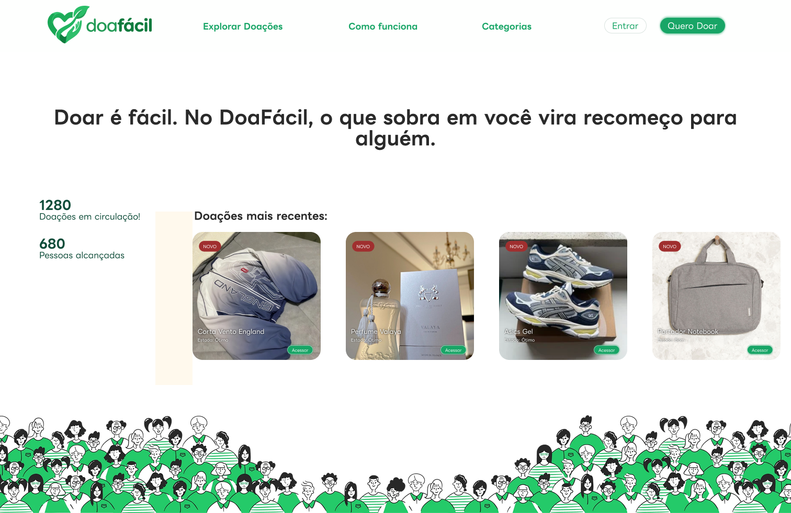
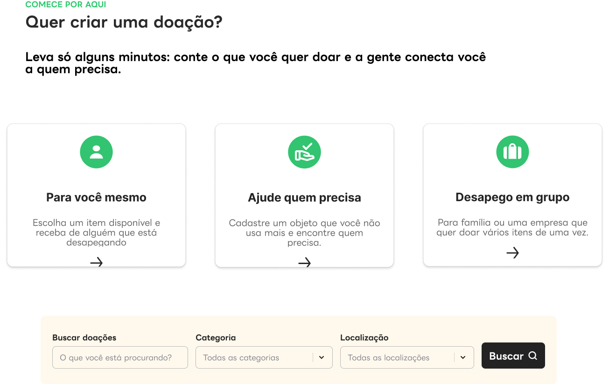
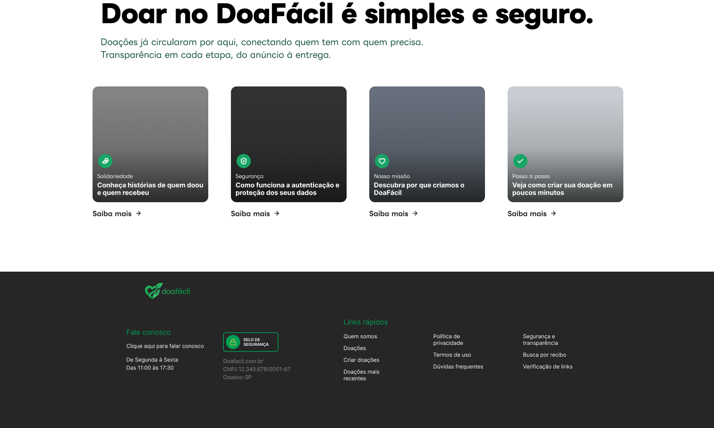
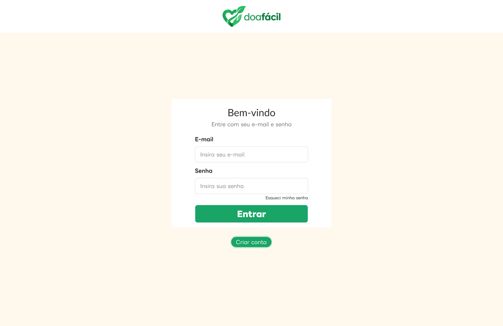
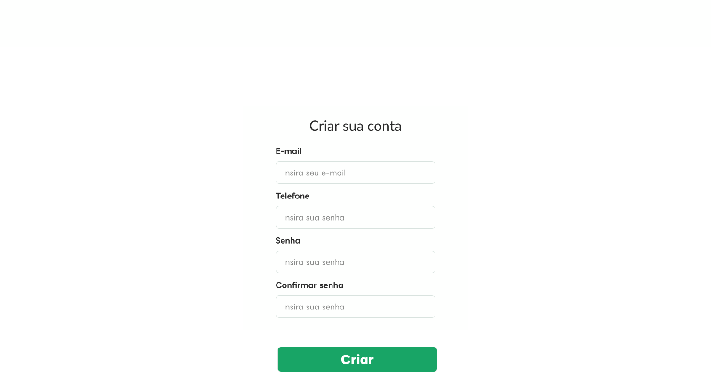

# Design do DoaFácil

Link do Figma: https://www.figma.com/design/l4MoQJUROh7b7gY3vCFTC0/doafacil?node-id=73-105&t=wvbRRiL16TnYnhQA-0

As imagens desta pasta são a referência visual do frontend (Reflex). O texto abaixo descreve cada tela e registra as decisões tomadas. Em caso de dúvida entre uma imagem e uma decisão de produto documentada, vale a decisão documentada.

## Identidade visual

- Cor principal: verde. Fundo das páginas: creme claro. Textos em cinza escuro.
- Logotipo "doafácil" (coração com mãos) e ilustração de pessoas no rodapé da home.
- As cores exatas e as fontes devem ser extraídas do Figma ao implementar.
- Páginas novas usam `auth-card-enter` no cartão central de formulários ou `page-fade-enter` no conteúdo principal das demais; ambas respeitam `prefers-reduced-motion`, sem animar cabeçalho, rodapé ou dados carregados do Xano.

## Telas prontas

### 01-home.png — Tela inicial

- Cabeçalho: logotipo, links **Explorar Doações**, **Como funciona** e **Categorias**, botão **Entrar** e botão **Quero Doar**. Com sessão autenticada, exibe “Olá, <primeiro nome>” e o botão **Sair** no lugar de **Entrar**; esse comportamento é um acréscimo que não está no Figma.
- Frase de destaque: "Doar é fácil. No DoaFácil, o que sobra em você vira recomeço para alguém."
- Estatística: "Doações em circulação".
- Seção **Doações mais recentes**: cartões com foto, etiqueta **NOVO**, título, **Condição** do item (Ótimo, Bom) e botão **Acessar**.
- Cabeçalho, destaque, doações recentes e ilustração ocupam no mínimo a altura da janela (100vh); a ilustração fica no limite inferior quando houver espaço, e "Comece por aqui" só aparece após rolar.
- Se o conteúdo inicial exceder a janela, a área cresce sem cortar conteúdo.
- Ilustração de pessoas em toda a largura, na parte de baixo da primeira área.

### 02-comece-aqui.png — Cartões de entrada

- Na home, esta seção aparece após "Doações mais recentes" e antes da seção institucional e do rodapé.
- A ilustração das pessoas permanece logo abaixo de "Doações mais recentes", em toda a largura e encostada à base da seção; não deve haver faixa de fundo creme entre ela e esta seção.
- Etiqueta "COMECE POR AQUI" e título.
- Abaixo do título, exibir em destaque e negrito: "Leva só alguns minutos: conte o que você quer doar e a gente conecta você a quem precisa."
- Três cartões:
  - **Para você mesmo**: "Escolha um item disponível e receba de alguém que está desapegando."
  - **Ajude quem precisa**: "Cadastre um objeto que você não usa mais e encontre quem precisa."
  - **Desapego em grupo**: "Para família ou uma empresa que quer doar vários itens de uma vez." Exibir a etiqueta **Em breve** e não exibir seta.
- As setas dos dois primeiros cartões são decorativas; nenhum cartão ou controle navega nesta change.
- Abaixo dos cartões, incluir uma barra de busca somente visual: campo "Buscar doações" com placeholder "O que você está procurando?", seletor "Categoria" com a opção "Todas as categorias", seletor "Localização" com a opção "Todas as localizações" e botão "Buscar". Nenhum campo ou botão realiza busca ou navega.
- Em telas estreitas, os campos da barra ficam em coluna.
- A seção usa padding superior próximo de 2.5rem e mantém o padding inferior atual de cerca de 5rem. Espaços: cerca de 1rem entre etiqueta e título, 1.5rem entre título e frase, 3rem entre frase e cartões, e 3rem entre cartões e busca. Line-height aproximado de 1.2 no título e 1.4 na frase.
- Cartões usam gap de cerca de 1.5rem e padding de cerca de 2rem; conteúdo alinhado no topo e seta ou "Em breve" no rodapé.
- Campo e seletores têm fundo branco e borda cinza clara; texto digitado em #333 e placeholder explicitamente em #6b6b6b com opacidade 1; valores dos seletores em cinza escuro legível (aparência ativa), embora a busca continue sem ação.

### 03-secao-institucional-e-rodape.png — Seção institucional e rodapé

**Seção institucional e rodapé da home**

- Título: "Doar no DoaFácil é simples e seguro."
- Texto: "Doações já circularam por aqui, conectando quem tem com quem precisa. Transparência em cada etapa, do anúncio à entrega."
- Quatro cartões com ícone, categoria, título e "Saiba mais", sem fotos ou vídeos:
  - **Solidariedade** — "Conheça histórias de quem doou e quem recebeu".
  - **Segurança** — "Como funciona a autenticação e proteção dos seus dados".
  - **Nossa missão** — "Descubra por que criamos o DoaFácil".
  - **Passo a passo** — "Veja como criar sua doação em poucos minutos".
- Os cartões usam fundos em degradê verde e cinza. Os destinos de "Saiba mais" ainda não existem; os controles não navegam nesta change.
- Rodapé em fundo escuro com logotipo; abaixo dele, duas colunas: "Fale conosco", com o texto "Clique aqui para falar conosco" sem navegação, e "Links rápidos", com os links Quem somos, Doações, Criar doações, Doações mais recentes, Política de privacidade, Termos de uso, Dúvidas frequentes e Segurança e transparência em tamanho reduzido e com pouco espaço entre linhas. Em telas estreitas, as colunas ficam empilhadas.
- Usar no rodapé o mesmo arquivo colorido `assets/logo.svg` do cabeçalho, sem filtro nem recoloração; se o contraste no fundo escuro for ruim, registrar o problema sem alterar a cor por conta própria.
- Títulos do rodapé em 15px; links e "Clique aqui para falar conosco" em 13px, com 6px entre linhas; "Projeto acadêmico DoaFácil" em 12px. "Clique aqui para falar conosco" sem sublinhado.
- Incluir a linha "Projeto acadêmico DoaFácil".
- Não incluir horário, e-mail ou telefone em "Fale conosco".
- Não incluir selo de segurança, CNPJ ou cidade, horário de atendimento, "Busca por recibo" ou "Verificação de links", itens herdados da referência do Vakinha.
- Em telas estreitas, os cartões das seções ficam em coluna.

## Telas ainda sem desenho

Login e cadastro, catálogo (Explorar Doações), detalhe da doação, formulário de cadastro da doação, Como funciona, Categorias.

## Referência de estrutura (Vakinha)

O site do Vakinha serve só de inspiração para a organização das páginas. Não copiar marca nem textos, e não incluir o que não se aplica ao DoaFácil: valores em reais, sorteios, avaliações de loja de aplicativos e botões de download de app (o projeto é uma plataforma web).

A referência serve apenas para inspiração estrutural, sem copiar marca ou incluir conteúdo que não tenha sido aprovado para o DoaFácil.

## Decisões tomadas

1. A **localização** da doação é a cidade e o estado do perfil do doador, copiados na hora de cadastrar a doação.
2. A barra de busca pertence à página **Explorar Doações**. A tela "Comece por aqui" é a porta de entrada.
3. A etiqueta **NOVO** vale para doações criadas nos últimos 7 dias.
4. A estatística "Pessoas alcançadas" **não entra** na primeira versão. Só "Doações em circulação".
5. **Desapego em grupo** (vários itens de uma vez) fica fora do MVP.
6. O rótulo do estado do item é **Condição** (Ótimo, Bom, Regular), para não confundir com o estado geográfico nem com o status da doação.
7. Na seção "Comece por aqui", exibir "Desapego em grupo" com a etiqueta "Em breve" e sem seta. A barra abaixo dos cartões é apenas visual nesta home e não executa busca nem navega; a busca funcional permanece exclusiva da página Explorar Doações.
8. Na seção institucional, usar os quatro cartões Solidariedade, Segurança, Nossa missão e Passo a passo com ícones, categorias, títulos e "Saiba mais", sem fotos ou vídeos; usar degradês verde e cinza. O cartão Solidariedade mantém o título "Conheça histórias de quem doou e quem recebeu", conforme a imagem de referência.
9. Os controles das seções novas, inclusive setas e links, não navegam nesta change porque suas páginas de destino ainda não existem.
10. O rodapé da home usa fundo escuro, logotipo, os oito links rápidos definidos acima e "Projeto acadêmico DoaFácil"; não inclui selo de segurança, CNPJ, cidade, horário de atendimento, "Busca por recibo" ou "Verificação de links" da referência do Vakinha.
11. As seções novas mantêm a fonte LINE Seed JP e a paleta já usada na home; a área principal segue creme e o rodapé é escuro.
12. A ilustração das pessoas permanece logo abaixo das doações recentes, ocupa toda a largura e encosta à base da seção, sem faixa de fundo creme entre ela e "Comece por aqui"; depois aparecem essa seção, a seção institucional e o rodapé escuro, nessa ordem.
13. O rodapé inclui "Fale conosco" com "Clique aqui para falar conosco", sem navegação nem dados de horário, e-mail ou telefone. O bloco fica ao lado de "Links rápidos" abaixo do logotipo em telas largas e empilhado em telas estreitas; título e links rápidos usam tipografia menor e linhas mais compactas.
14. A primeira área da home (cabeçalho, destaque, doações recentes e ilustração) tem no mínimo 100vh, com ilustração encostada à base e sem exibir “Comece por aqui” na primeira dobra; quando o conteúdo ultrapassa a viewport, a área cresce sem cortes.
15. A seção “Comece por aqui” usa espaçamentos e cartões arejados conforme definidos acima; a busca visual tem controles brancos, borda cinza clara e texto legível, sem executar busca.
16. O rodapé preserva o logotipo colorido original, sem filtro; títulos em 15px, links e contato em 13px com 6px entre linhas, texto acadêmico em 12px e texto de contato sem sublinhado.

## Cadastro de doação: integração com o backend (Xano)

- O wizard usa `/catalog/categories` para carregar categorias e `/auth/profile` para exibir a cidade e a UF do perfil autenticado.
- A publicação completa usa `POST /catalog/donations/publish`; o Xano deriva o doador e a localização da sessão autenticada, valida os campos e persiste até cinco fotos, mantendo a primeira como foto de capa.
- Os arquivos locais em `xano/` incluem os campos aditivos de modalidade de entrega, preferência de contato e localização, além da tabela de fotos e do endpoint de publicação. O `dry-run` do workspace 168184 foi revisado; nenhuma alteração foi enviada ao workspace compartilhado.
- A contagem de doações em circulação e a listagem pública são funcionalidades separadas deste fluxo.

## Telas (imagens)

## Novas telas

### 04-login.png — Login

- Cabeçalho branco com o logotipo colorido centralizado; fundo creme na página.
- Cartão branco centralizado com o título "Bem-vindo" e o subtítulo "Entre com seu e-mail e senha".
- Campo "E-mail" com o texto interno "Insira seu e-mail" e campo "Senha" com o texto interno "Insira sua senha".
- O campo Senha tem um botão de olho para mostrar ou ocultar a senha, acréscimo que não está no PNG do Figma.
- O cartão tem uma animação suave de entrada, acréscimo que não está no PNG do Figma.
- Link "← Voltar" acima do cartão, alinhado à esquerda, que retorna para a home em `/`.
- Link pequeno "Esqueci minha senha", alinhado à direita abaixo do campo de senha, sem destino por enquanto.
- Botão verde largo "Entrar".
- Abaixo do cartão, botão pequeno em forma de pílula "Criar conta", que leva para `/cadastro`.
- O login é somente por e-mail. O design original indicava "e-mail ou CPF", mas o CPF foi removido porque o Xano autentica apenas por e-mail e o grupo não decidiu armazenar CPF.

### 05-cadastro-de-conta.png — Cadastro de conta

- Cabeçalho branco com o logotipo colorido centralizado e fundo creme, iguais aos do login; o PNG está sem o logo e com fundo branco, mas esta descrição prevalece sobre a imagem.
- Cartão branco com o título "Criar sua conta" e os campos, nesta ordem: Nome, E-mail, Cidade, Estado, Senha e Confirmar senha. Estado oferece as 27 siglas de UF. Botão verde "Criar".
- Telefone ficou de fora: não existe campo correspondente no Xano e nenhuma funcionalidade deste escopo o utiliza.
- Nome, Cidade, Estado, os botões de olho para mostrar/ocultar as senhas e o link "← Voltar" acima do cartão, alinhado à esquerda e com destino `/login`, são acréscimos que não estão no PNG do Figma.
- O cartão tem uma animação suave de entrada, acréscimo que não está no PNG do Figma.
- O PNG pode conter textos internos desatualizados, como menção a CPF no campo de e-mail e texto incorreto no campo Telefone. Esta descrição prevalece sobre a imagem.

## Cadastro de doação em cinco etapas

As telas de referência adicionadas são:

- [06-cadastro-de-doacao.png](./06-cadastro-de-doacao.png) — item.
- [07-detalhamento-doacao.png](./07-detalhamento-doacao.png) — descrição e categoria.
- [08-fotos-doacao.png](./08-fotos-doacao.png) — seleção de fotos.
- [09-entrega-doacao.png](./09-entrega-doacao.png) — localização e entrega.
- [10-formas-de-contato.png](./10-formas-de-contato.png) — contato e publicação.

1. **Item:** nome da doação.
2. **Detalhes:** descrição, categoria existente e condição (Ótimo, Bom ou Regular).
3. **Fotos:** pelo menos uma e até cinco imagens JPEG, PNG, GIF ou WEBP são necessárias para continuar no wizard e publicar a doação.
4. **Entrega:** modalidade (Retirada, Entrega ou A combinar) e cidade/UF do perfil, sem endereço específico.
5. **Contato e publicação:** preferência (WhatsApp, E-mail ou Chat do DoaFácil), sem solicitar telefone ou outro identificador de contato.

As imagens originais indicam oito etapas e mostram a condição no último passo; o fluxo aprovado nesta change reduz a navegação a cinco etapas e coleta a condição no passo 2. A página usa cabeçalho branco com logotipo centralizado, fundo creme `#FFF6E8`, conteúdo estreito centralizado e animação `auth-card-enter`, que respeita `prefers-reduced-motion`. Os botões primários usam um tom mais escuro de verde com texto branco para manter contraste legível; a barra de progresso conserva `#00A859`. O indicador mostra “Passo X de 5”; a navegação preserva os campos, e erros de serviço não apagam o formulário nem mostram confirmação de publicação.

- **Seta de retorno:** fica no canto superior esquerdo, logo abaixo do cabeçalho, numa faixa de largura total com recuo lateral de 1,25 rem, como no PNG. Não acompanha a coluna centralizada do wizard, fica na mesma posição nas cinco etapas e leva à home (`/`), com o rótulo acessível “Voltar ao início”.
- **Cor dos campos de texto:** em “Nome do item” e “Descrição”, o texto digitado ou colado usa `#1F1F1F`, opaco, aplicado direto no campo para não depender do tema claro ou escuro do sistema. O placeholder usa `#6B6B6B`, igual aos outros formulários, para não parecer texto digitado, e volta a aparecer quando o campo é apagado. Como o placeholder herda o `-webkit-text-fill-color` do campo, a cor dele também é definida nessa propriedade. Os prompts de seleção (“Selecione uma categoria” etc.) e as preferências de contato continuam `#333333`.

## Recuperação de senha

### 11-esqueci-senha.png — Solicitar código

- Cartão central com o título “Esqueceu a senha?”, campo E-mail e botão “Continuar”; o link “← Voltar” retorna ao login.
- Cabeçalho branco com logotipo, fundo creme e animação `auth-card-enter` somente no cartão.
- A animação e o retorno ao login são acréscimos que não estão no Figma.

### 12-verifique-email.png — Verificar código

- Cartão com o título “Verifique seu e-mail”, campo Código de seis dígitos, dica para verificar o spam, contagem “Reenviar código em 0:30” e botão “Continuar”.
- A tela também é usada para confirmar o cadastro. No fluxo de recuperação, mantém a mensagem neutra atual: “Se existir uma conta com esse e-mail, enviamos um código de 6 dígitos para <e-mail mascarado>.” No fluxo de cadastro, mostra “Se for possível confirmar este e-mail, enviaremos um código de 6 dígitos para <e-mail mascarado>.”
- Em ambos os fluxos, oferece “Usar outro e-mail”. “← Voltar” retorna à solicitação no fluxo de recuperação e a `/cadastro` no fluxo de cadastro.
- Após a confirmação do cadastro, o login mostra o aviso verde “Cadastro confirmado! Você já pode entrar com seu e-mail e sua senha.” abaixo do link “Esqueci minha senha”.
- A máscara, as mensagens neutras, a dica, a contagem, os links, o cabeçalho, o uso compartilhado com cadastro, o aviso de cadastro no login e a animação `auth-card-enter` são acréscimos que não estão no Figma.

### 13-nova-senha.png — Definir nova senha

- Cartão com o título “Altere sua senha”, campos “Nova senha” e “Confirmar senha” e botão “Salvar nova senha”.
- Cada campo tem controle de olho independente; “← Voltar” retorna ao login. Após salvar, o login mostra uma faixa verde de sucesso.
- Os controles de olho, o retorno, a faixa verde e a animação `auth-card-enter` são acréscimos que não estão no Figma.

## Detalhe da doação

### 14-detalhe-doacao.png e 15-detalhe-doacao-resumido.png — Uma página

- As duas imagens representam uma única página de detalhe, não telas ou etapas diferentes.
- A imagem 14 mostra a página inteira, incluindo a galeria, os detalhes e a localização após rolar. A imagem 15 mostra o topo da mesma página, antes de rolar.
- A página usa cabeçalho branco com o logotipo, fundo creme, galeria de fotos e resumo da doação. Abaixo aparecem os detalhes, a localização e o cartão mínimo de quem doa.
- O conteúdo aprovado inclui título, condição, descrição, categoria, cidade/UF, modalidade de entrega e preferência de contato escrita como texto. O cartão de quem doa mostra somente o primeiro nome e a cidade/UF da doação.
- A página é pública e exibe somente doações disponíveis. Um identificador inválido, uma doação inexistente ou uma doação indisponível apresenta “Doação não encontrada”. Falhas de rede ou respostas inválidas apresentam uma mensagem de erro.
- O conteúdo estático usa `page-fade-enter`, respeitando `prefers-reduced-motion`; cabeçalho e dados carregados do Xano não são animados.

### Frames `detalhes-doacao-inteira` e `detalhes-doacao-1` do Figma — layout atual

A referência de layout são esses dois frames do Figma, que só diferem no cartão do anunciante. Esta seção prevalece sobre eles e sobre as imagens 14 e 15.

O que segue o Figma:

- **Cabeçalho:** branco, com o logotipo centralizado e “Voltar ao início” à esquerda na mesma linha. É o mesmo cabeçalho do chat (`back_home_header()`), com seta verde `#166B3B` e rótulo acessível “Voltar ao início”. Em telas estreitas aparece só a seta, numa área de toque de 44 px.
- **Galeria:** a capa grande (470 px de altura no computador) e, ao lado, até 4 miniaturas em grade 2×2, com 16 px entre as fotos e cantos de 8 px.
- **Uma foto só:** a capa ocupa toda a largura da galeria e mostra a imagem inteira (`contain`), centralizada, com fundo neutro `#EEEEEE` nas sobras e a mesma altura. Nada é cortado.
- **Cartão de resumo, à direita da galeria:**
  - branco, com borda `#D9D9D9`, cantos de 8 px e sombra `0 8px 13px rgba(0,0,0,0.15)`;
  - o título grande (2,4 rem) e “Condição: …”;
  - o botão em pílula “Outros meios de comunicação” e o botão “Chat” branco com borda `#85858D`.
- **Título e descrição logo abaixo da galeria:** o título em negrito, em caixa alta e preto; a descrição em texto corrido, mantendo as quebras de linha. O título aparece nos dois lugares, como no Figma.
- **“Detalhes”:** uma grade em que cada item tem o ícone verde do Figma (`assets/detalhe-atributo.svg`), um rótulo pequeno e o valor logo abaixo. Os itens são Categoria, Condição, Forma de entrega e Preferência de contato. A grade tem 4 colunas em telas largas, 2 em médias e 1 no celular.
- **“Localização”:** a ilustração de edifícios do Figma (`assets/detalhe-localizacao.svg`, 56 px) e “Cidade, UF”.
- **“Quem doa”:** à direita, abaixo do resumo, como o cartão do anunciante do Figma: branco, com borda `#D9D9D9`, o primeiro nome e o ícone de local com “Cidade, UF”.
- **No celular:** uma coluna, na ordem galeria → resumo → título e descrição → Detalhes → Localização → Quem doa, com 16 px de margem e sem rolagem horizontal.

Diferenças aprovadas em relação ao Figma:

- **Botão principal em `#007A42`** (o verde AA do projeto, hover `#006B39`), no lugar do `#007D32` do Figma e do `#00A859` antigo, que tinha cerca de 2,9:1 com o texto branco.
- **Fonte LINE Seed JP** em tudo, como no resto do site, no lugar da Roboto do Figma.
- **Rótulos da grade com 0,75 rem** (12 px), e não 10 px, para ficarem legíveis. O texto usa `#2A2A2A` e `#555555`, e o cartão de quem doa `#001C3C`, todos com contraste AA.
- **Fundo creme `#FFF6E8`**, como no resto do site, no lugar do `#FFF9ED`.
- **“Condição”** no lugar do “Estado” do Figma, como pede a spec.
- **Caixa alta do título só no visual** (`text-transform: uppercase`); o texto lido continua o original.
- **“Localização” num cartão branco** com borda, no lugar das divisórias do Figma, e com uma só linha: “Cidade, UF”.
- **Sem “NOVO” e sem status:** o detalhe não recebe a data de criação e só mostra doações disponíveis (decisão do grupo).
- **Ícones decorativos:** os dois SVGs do Figma têm `alt=""` e `aria-hidden`.
- **Visualizador de fotos (não está no Figma):** cada foto da galeria é um botão, com rótulo como “Ampliar foto 2 de 5” e cursor de lupa.
  - **Abrir:** clicar, Enter ou Espaço abre um modal em tela cheia com fundo creme semitransparente (`rgba(255, 246, 232, 0.85)`) e desfoque de 6 px, sem o véu escuro padrão do diálogo. Textos e ícones em `#1F1F1F`.
  - **Foto em 1x:** inteira (`contain`), cabendo abaixo do cabeçalho de 80 px, sem passar da borda de baixo nem das laterais.
  - **Controles:**
    - no alto, o contador “N de M” e o botão X (“Fechar”);
    - nas laterais, ‹ (“Foto anterior”) e › (“Próxima foto”), que dão a volta e só existem com mais de uma foto;
    - todos com 48 px, fundo branco, sombra leve e ícone escuro, a 16 px das bordas visíveis em qualquer largura.
  - **Zoom:** clicar na foto alterna entre 1x e 2x (“Ampliar foto” / “Reduzir foto”); em 2x, a rolagem move a imagem. No celular vale a pinça do navegador.
  - **Teclado e fechamento:** ← e → trocam a foto; Esc, o X ou um clique no fundo fecham. O foco fica preso no modal e volta à página ao fechar (diálogo do Radix).

### Elementos fora do escopo desta versão

Cor, Material e Tipo, que aparecem no Figma, não existem no cadastro e não são criados. Bairro, zona, CEP e dados além do primeiro nome do doador são omitidos para preservar a privacidade: a localização pública é só cidade e UF. Avaliações, histórico de doações, presença online, indicadores de verificação e foto de perfil dependem de dados ou funcionalidades que ainda não existem. O cartão do topo mostra "Outros meios de comunicação", que abre o e-mail de quem doa só para quem está logado e só quando a preferência é E-mail, e "Chat", que inicia ou reabre a conversa e abre `/chat` (veja a seção “Chat”). O botão Acessar perfil do doador continua oculto porque o perfil público não foi implementado, e não é apresentado como “Em breve”.
## Chat

### Frame `chat-1` do Figma — página `/chat`

A referência é o frame `chat-1` do arquivo do Figma (ainda sem PNG em `docs/design`). Esta seção prevalece sobre o frame.

O que segue o Figma:

- Cabeçalho branco com o logotipo centralizado e “← Voltar ao início” (link para `/`) alinhado à esquerda na mesma linha, sem faixa própria. Em telas estreitas aparece só a seta, com o rótulo acessível “Voltar ao início”.
- Fundo creme na área das mensagens, com 24 px de espaço lateral para as bolhas não encostarem nas bordas; a lista usa 16 px de espaço lateral no título “Conversas” e nos itens.
- Lista de conversas à esquerda (cerca de 280 px, fundo branco, itens com divisória clara) e conversa à direita, separadas por uma linha verde `#18A566`.
- Cabeçalho da conversa com cerca de 52 px, fundo branco, texto centralizado e linha verde embaixo.
- Bolhas com largura máxima de 450 px, `padding` de 10 px, cantos de 8 px, sombra leve e texto em negrito: as da própria pessoa à direita, as da outra pessoa à esquerda.
- Separador de dia em forma de pílula (“Hoje”, “Ontem” ou dd/mm/aaaa).
- Campo “Digite aqui...” com fundo branco, borda `#18A566` e cantos de 4 px.

Diferenças aprovadas em relação ao Figma:

- **Sem foto e sem “Online”:** cada pessoa aparece com um círculo verde `#00A859` com a inicial do primeiro nome. Não há indicador de presença.
- **Título da doação:** na lista, abaixo do primeiro nome, e no cabeçalho da conversa, no lugar da prévia da última mensagem (que o backend não fornece) e do “Online”.
- **Botão “Enviar”** ao lado do campo; Enter também envia. O ícone de imagem do frame (anexar fotos) não foi implementado: o chat só aceita texto.
- **Cores com contraste AA:** o Figma usa texto branco sobre cinza `#CDD2DF` e sobre verde `#32C470`, o que fica abaixo do contraste mínimo. As bolhas recebidas usam fundo `#E9ECEF` com texto `#1F1F1F`; as enviadas, `#007A42` (o verde dos botões primários) com texto branco. A pílula do dia também usa `#007A42`.
- **Tamanhos de texto legíveis:** o frame usa 8 px no subtítulo da lista e no placeholder; aqui são 0,75 rem e o tamanho padrão do campo. O placeholder usa `#6B6B6B`, como nos outros formulários.
- **Controles acrescentados:** “Conversas” com o botão “Atualizar conversas” no topo da lista, “Carregar mais conversas”, “Carregar anteriores” no topo das mensagens, “Tentar novamente” em erro e, em telas estreitas, “Voltar às conversas”.
- **Telas estreitas:** a lista e a conversa aparecem uma de cada vez.
- **Textos neutros:** “Você ainda não tem conversas.”, “Escolha uma conversa para ver as mensagens.” e “Ainda não há mensagens. Escreva a primeira.”. As mensagens do mockup não são usadas.
- **Horário de envio:** embaixo de cada bolha, do mesmo lado dela, em HH:MM no fuso de Brasília, fonte pequena e cor `#6b6b6b`. Não está no Figma.
- **Campo sem autocompletar:** o campo “Digite aqui...” tem `autocomplete="off"`, para o navegador não sugerir textos anteriores.
- **Somente leitura:** numa doação concluída, o campo e o botão ficam desativados, com o aviso “Esta doação foi concluída. A conversa fica disponível somente para leitura.”.
- **Animação:** o conteúdo principal usa `page-fade-enter`, que respeita `prefers-reduced-motion`; o cabeçalho e as mensagens carregadas depois não ganham animação própria.
- **Contador de não lidas na lista:** não está no Figma.
  - Mensagens não lidas aparecem num círculo à direita do item, como nos aplicativos de mensagem.
  - O círculo tem fundo `#007A42`, número branco em negrito de 0,7 rem, altura de 20 px e cantos totalmente arredondados.
  - Acima de 99, mostra “99+”. Com zero não aparece, e a conversa aberta nunca mostra contador.
  - O rótulo acessível diz o número real (“1 mensagem não lida”, “150 mensagens não lidas”).
- **Botão flutuante “Mensagens”** (como no Figma da home), no lugar do antigo link “Mensagens” do cabeçalho, que saiu:
  - **Aparência:** círculo `#007A42` de 56 px com o ícone `message-circle` branco e sombra leve, fixo no canto inferior direito, a 24 px das bordas no computador e a 16 px no celular.
  - **Contador:** círculo vermelho `#C62828` com número branco (5,6:1, AA) e borda branca, no canto superior direito do botão. Mostra “99+” acima de 99 e não aparece com zero, sem login ou se a consulta falhar. Usa a mesma consulta única de não lidas por carregamento, sem atualização automática.
  - **Rótulo e destino:** com login, “Mensagens” ou “Mensagens, N não lidas”, e abre `/chat`. Sem login, “Mensagens”, vai para `/login` e não consulta o Xano. O contador fica oculto do leitor de tela, porque o total já está no rótulo.
  - **Onde aparece:** só na home, por enquanto. É o componente `chat_fab()`, para reutilizar nas próximas telas que forem pedidas.
    - Não aparece no detalhe da doação, que já tem o botão “Chat” da própria doação; dois botões de chat confundiriam.
    - Também não aparece em `/chat`, `/login`, `/cadastro`, `/verificar-email`, `/recuperar-senha`, `/nova-senha` e `/cadastro-doacao`.
  - **Espaço no fim:** a home reserva no fim do rodapé 88 px no celular e 104 px no computador (o botão mais as margens). Com a página rolada até o fim, nenhum botão de ação fica coberto.
  - **Realce:** ao passar o mouse ou focar, o botão sobe 2 px e a sombra aumenta; o foco tem contorno `#1F1F1F`. Com `prefers-reduced-motion`, não há transição nem deslocamento (`assets/chat.css`). Não tem animação de entrada.
- **“Visto” nas próprias mensagens:** não está no Figma. Fica na linha do horário, embaixo da bolha e fora dela, como `12:41 (editada) ✓✓`. Dentro da bolha verde, um ícone cinza ou verde não teria contraste.
  - **✓ (enviada):** ícone `check` em `#6b6b6b`, a cor do horário, com rótulo acessível “Enviada”.
  - **✓✓ (lida):** ícone `check-check` em `#007A42`, com rótulo acessível “Lida”. Sobre o creme `#FFF6E8`, fica em torno de 5:1.
  - Nas mensagens da outra pessoa não aparece nada.
- **“(editada)”:** na mesma linha, depois do horário, em `#6b6b6b` e 0,7 rem, para as duas pessoas.
- **Lápis de edição:** botão fantasma com o ícone `pencil`, à esquerda da própria bolha, com rótulo acessível “Editar mensagem”.
  - Só aparece nas próprias mensagens enviadas há até 15 minutos, fora de conversa somente leitura.
  - No computador, aparece ao passar o mouse na linha da mensagem; no celular, ao tocar na bolha (outro toque esconde). Também aparece ao receber foco pelo teclado.
  - Escondido, ele não recebe cliques. A regra está em `assets/chat.css`, sem transição.
- **Modo de edição no campo de baixo:**
  - Acima do campo aparece a faixa “Editando mensagem”, em `#E8F5EC` com texto `#166B3B`. No computador, ela também mostra “(Esc cancela)”.
  - O campo recebe o texto atual e o foco.
  - “Enviar” vira “Salvar”, com o ícone `check`, e aparece “Cancelar” com contorno verde.
  - Enter salva, e Esc ou “Cancelar” saem sem salvar.
- **Por que `#007A42` e não `#00A859`:** o verde do avatar (`#00A859`) não chega a 4,5:1 com texto branco em fonte pequena. O `#007A42`, o mesmo das bolhas enviadas e da pílula do dia, chega a esse contraste (AA).